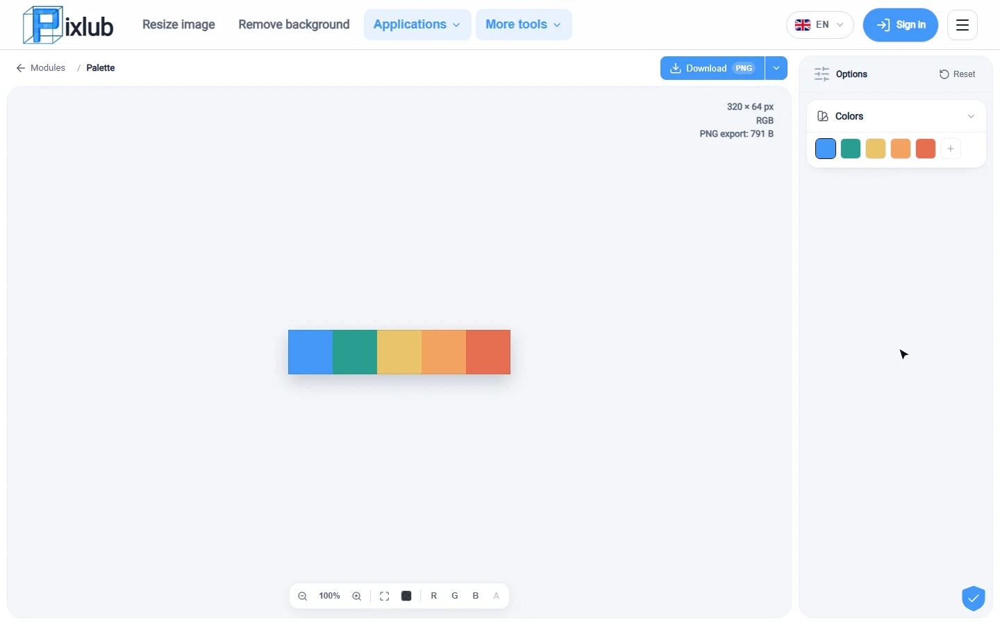

# Palette

Define a colour palette, to export or to reuse in the graph.

**Category** : Generation · **Identifier** : `palette`

## Where to use it

- **[Module page](https://pixlub.com/en/module/palette)** : Drop your files, adjust, download: the module on its own, nothing else.
- **[Image graph](https://pixlub.com/en/image/graph)** : Connect it to other modules to build a richer effect.

## Inputs

This module has no input: it creates the image from its settings alone.

## Video walkthrough

▶ [Watch the video](../../../../assets/modules/palette/demo.en.mp4) : Change a colour, add one.

1. `0:00` The render shows right away
2. `0:01` Change a colour
3. `0:06` Add a colour
4. `0:09` Export the result

## How to use

1. **Change a colour**

   Click a swatch, then pick the colour (HEX, swatches or eyedropper).

2. **Add or remove**

   **+** adds a colour; up to 32.

## Settings

| Setting | Effect |
| --- | --- |
| **Colors** | 1 to 32 colours, rendered as bands. |

## Tips

- In the [image graph](../../../../01-app/en/02-image/01-image-graph.md), a palette feeds the recolouring modules.

## Export

The **Download** button saves the result in the format of the imported file: a JPEG photo comes out as JPEG. The menu on its right opens the **Export settings** to pick another format, set the quality, size or background, and offers **Copy image**.

- **[The export dialog](../../../../01-app/en/02-image/04-exportation.md)** : Every format, its settings, local or server processing, batches and the local folder.
