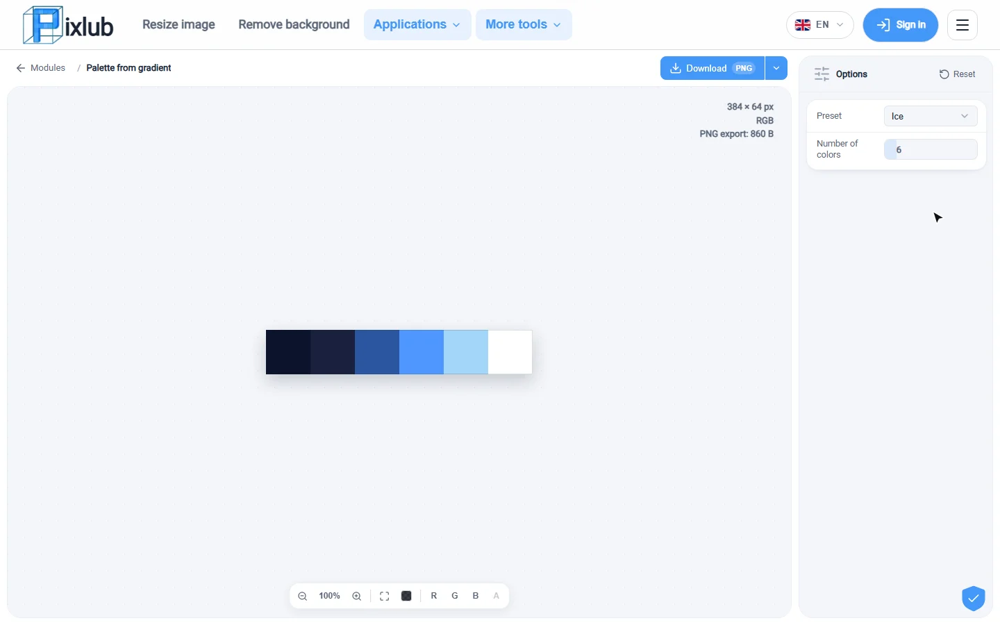

# Palette from gradient

Cut a gradient into a fixed number of colours.

**Category** : Generation · **Identifier** : `paletteFromGradient`

## Where to use it

- **[Module page](https://pixlub.com/en/module/paletteFromGradient)** : Drop your files, adjust, download: the module on its own, nothing else.
- **[Image graph](https://pixlub.com/en/image/graph)** : Connect it to other modules to build a richer effect.

## Inputs

This module has no input: it creates the image from its settings alone.

## Video walkthrough

▶ [Watch the video](../../../../assets/modules/paletteFromGradient/demo.en.mp4) : Ready-made gradients, then number of colours.

1. `0:00` The render shows right away
2. `0:01` Start from a ready-made gradient
3. `0:08` Number of colours
4. `0:12` Export the result

## How to use

1. **Pick a gradient**

   A **preset** (dusk, fire, ice…) or **Custom** to draw your own.

2. **Pick the count**

   The gradient is sampled at regular steps.

## Settings

| Setting | Effect |
| --- | --- |
| **Preset** | Custom, Dusk, Fire, Ice, Forest, Pastel, Grayscale. |
| **Number of colors** | 2 to 32. |
| **Gradient** | In Custom: the gradient stops. |

## Tips

- Handy for an even colour scale (charts, heat maps).

## Export

The **Download** button saves the result in the format of the imported file: a JPEG photo comes out as JPEG. The menu on its right opens the **Export settings** to pick another format, set the quality, size or background, and offers **Copy image**.

- **[The export dialog](../../../../01-app/en/02-image/04-exportation.md)** : Every format, its settings, local or server processing, batches and the local folder.
