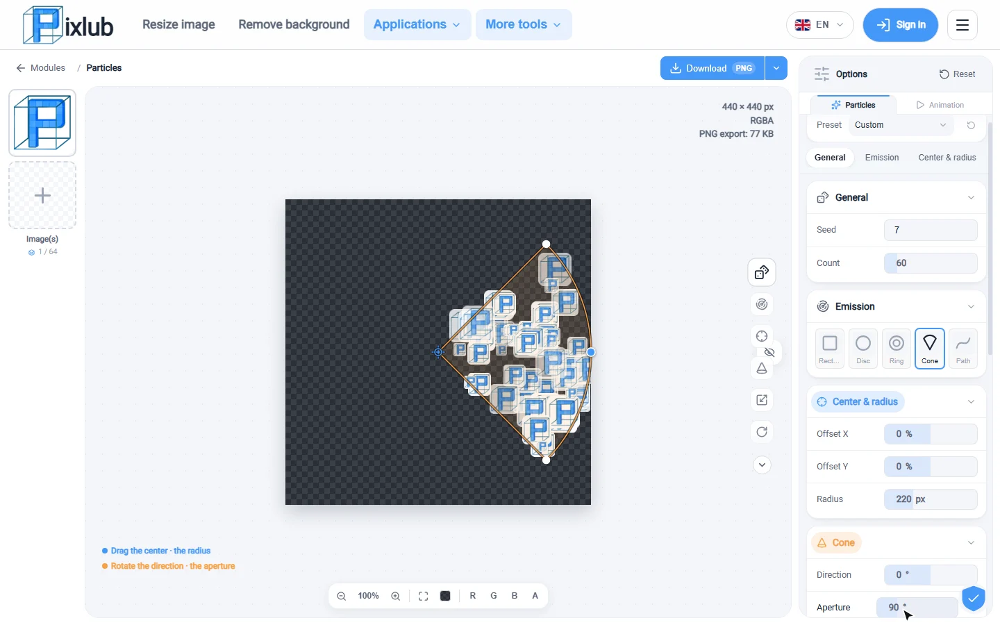
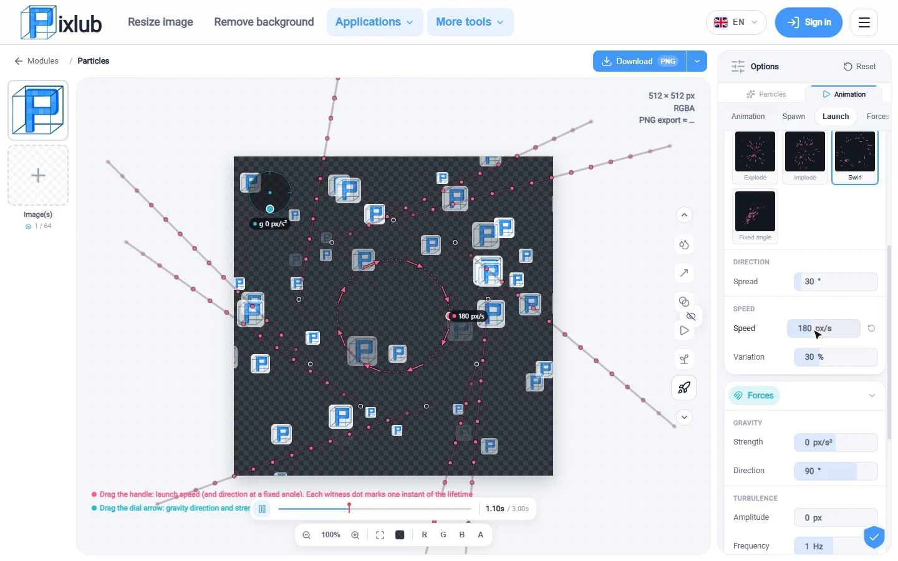

# Particles

Scatter an image into particles, still or animated: emission shape, size, trails, motion.

**Category** : Generation · **Identifier** : `particles` · [API reference](./api.md)

## Where to use it

- **[Module page](https://pixlub.com/en/module/particles)** : Drop your files, adjust, download: the module on its own, nothing else.
- **[Image graph](https://pixlub.com/en/image/graph)** : Connect it to other modules to build a richer effect.

## Inputs

The files the module page accepts: drop them on the import area, or click it to browse. A file in another format is set aside, with a message listing the allowed formats.

| Input | Accepted formats | Files |
| --- | --- | --- |
| **Image(s)** (required) Image scattered into particles; a batch mixes its images across the particles. | `PNG`, `JPEG`, `WebP`, `GIF`, `AVIF`, `BMP` | Up to 64 files, gathered in a batch |

Through the API, the files and their formats are detailed in the [API view](./api.md).

## Video walkthrough

▶ [Watch the video](../../../../assets/modules/particles/demo.en.mp4) : Still particles: count, emission shape, size, rotation, trail, preset.

1. `0:00` Import the image to scatter
2. `0:02` Count and seed
3. `0:07` Emission shape: cone
4. `0:11` Random size and rotation
5. `0:19` Trail along the motion
6. `0:24` Or a still preset
7. `0:31` Export the result

## How to use

1. **Import**

   Drop the image to scatter. A batch mixes its images across the particles.

2. **Scatter**

   **Count** and **seed**, then the **emission shape**: rectangle, disc, ring, cone or path.

3. **Vary**

   Min / max sizes, rotations and opacities: each particle draws its value between the two.

Without animation, the module renders a still image. A **preset** (snow, bokeh, confetti…) sets everything at once; the **Animated / Still** filter sorts them.

## Settings (Particles tab)

| Setting | Effect |
| --- | --- |
| **Seed** / **Count** | Draw and quantity (1 to 3000). Another seed redistributes everything. |
| **Emission shape** | Rectangle, disc, ring, cone or path, with center, radius, aperture… |
| **Size**, **Rotation**, **Opacity** | Random min and max bounds. |
| **Direction & trail** | Orient along direction, trail length and falloff. |
| **Rendering** | Blend mode of a particle over the others. |

## Animating particles

▶ [Watch the video](../../../../assets/modules/particles/motion.en.mp4) : Animation: spawn, launch, forces, end of life, playback, animated preset, GIF export.

1. `0:00` Import the image to scatter
2. `0:05` Turn the animation on
3. `0:10` Spawn: looping, lifetime
4. `0:14` Launch: swirl and speed
5. `0:22` Forces: gravity
6. `0:26` Over lifetime: fade and size
7. `0:34` Play, pause, scrub
8. `0:42` Or an animated preset
9. `0:52` Export as an animated GIF

1. **Turn the animation on**

   **Animation** tab, check **Animate particles**: the preview starts playing in a loop.

2. **Set the spawn**

   **Loop** (continuous flow), **Once** (one burst after a delay) or **Frozen** (a single instant). The **lifetime** sets how long a particle lives.

3. **Launch and push**

   **Launch**: explode, implode, swirl or fixed angle, with speed and spread. **Forces**: gravity, turbulence, drag.

4. **Make them live and die**

   **Over lifetime**: fade in, fade out, end-of-life size, spin.

5. **Export**

   Below the preview, the mini timeline plays, pauses and scrubs the animation. In **Export settings**, **Animated** tab: **Animated GIF** or **APNG**.

| Setting | Effect |
| --- | --- |
| **Spawn** | Loop, once (with a **delay**) or frozen (with a **phase**). |
| **Lifetime** | 0 to 20 s per particle. The loop lasts a whole number of lifetimes: it joins without a jump. |
| **Launch** | Direction (explode, implode, swirl, fixed angle), spread, speed and its variation. |
| **Forces** | Gravity (strength and direction), turbulence (amplitude, frequency), drag. |
| **Over lifetime** | Fade in and fade out (share of the lifetime), end size, spin speed. |
| **Drive by phase** | The animation no longer follows time on its own: its **phase** (0 to 100%) is keyed. |

In the preview, the pink handle sets the launch speed, the dial at the top left the gravity direction and strength; the marker dots trace the path at regular intervals.

### In the image graph

An animated Particles module plays on its own in the [image graph](../../../../01-app/en/02-image/01-image-graph.md#animation): the time strip opens and the loop takes the animation's length. To sync it with other elements, check **Drive by phase** and key **Phase** on the timeline (0%: start, 100%: end). Export through the **Export** module, APNG by default.

## Tips

- For a seamless loop, keep the animation length a multiple of the **lifetime**.
- **Frozen** + **Phase** gives a still image of a precise instant of the animation (an explosion halfway, for instance).
- A GIF keeps only 256 colours: for soft or transparent particles, prefer APNG.

## Export

The **Download** button saves the result in the format of the imported file: a JPEG photo comes out as JPEG. The menu on its right opens the **Export settings** to pick another format, set the quality, size or background, and offers **Copy image**.

With several images, the button becomes **ZIP download**; the menu also offers separate files, or only the image on display.

- **[The export dialog](../../../../01-app/en/02-image/04-exportation.md)** : Every format, its settings, local or server processing, batches and the local folder.
