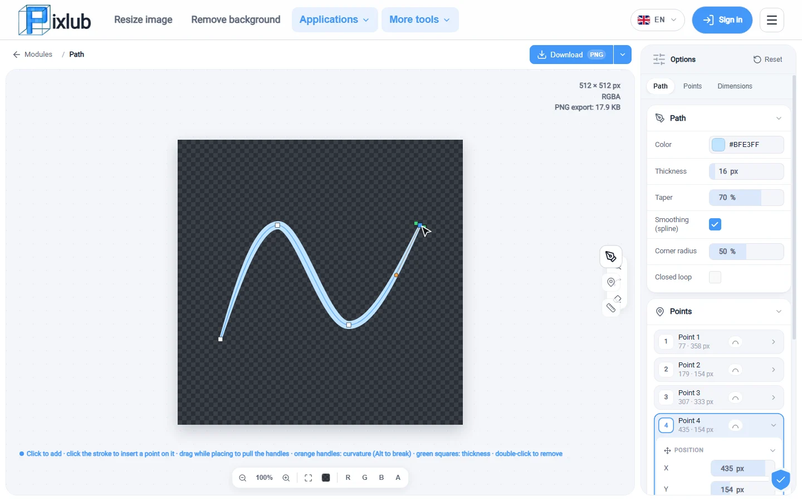

# Path

Draw vector paths: pen, pencil, shapes, tapered strokes and fills.

**Category** : Generation · **Identifier** : `pathStroke`

## Where to use it

- **[Module page](https://pixlub.com/en/module/pathStroke)** : Drop your files, adjust, download: the module on its own, nothing else.
- **[Image graph](https://pixlub.com/en/image/graph)** : Connect it to other modules to build a richer effect.

## Inputs

This module has no input: it creates the image from its settings alone.

## Video walkthrough

▶ [Watch the video](../../../../assets/modules/pathStroke/demo.en.mp4) : Draw the path, thickness and taper, colour.

1. `0:00` The render shows right away
2. `0:01` Draw the path
3. `0:07` Thickness and taper
4. `0:13` Colour
5. `0:18` Export the result

## How to use

1. **Pick a mode**

   The bar at the top of the preview offers two modes. **Base** gives the usual vector tools. **Rounded** places points joined by arcs, for loops and circles.

2. **Draw**

   In Base mode, take the **pen** (a click places a sharp point, a drag pulls a curve), the **pencil** (a freehand stroke becomes a smoothed path) or a **shape**: line, rectangle, ellipse, polygon, star. Each drawing adds a path to the list.

3. **Refine**

   The **selection** tool moves, resizes and rotates whole paths. The **direct selection** tool moves the points, their curvature handles and their local thickness. The **scissors** cut a path.

4. **Set the look**

   The **layers**, at the bottom left of the preview, hold the paths and unfold on their points. The right panel shows the sheet of the chosen path: stroke, fill, taper, dashes, opacity.

## Base mode tools

| Tool | Key | Gestures |
| --- | --- | --- |
| **Selection** | V | Click a path (**Shift**: several), drag it (**Alt**: copy), pull the box handles, rotate around it. Double-click: edit its points. |
| **Direct selection** | A | Drag a point or its orange handles (**Alt**: break, **Ctrl**: symmetric). **Alt** + drag a point: pull new handles. Green squares: local thickness. Double-click: sharp or rounded point. |
| **Pen** | P | Click: sharp point. Drag: curve. Click the first point: close. Click an end: extend. Click the chosen stroke: insert a point. Click a point: remove it (**Alt**: sharp or rounded). **Enter** or double-click: finish. |
| **Pencil** | N | Draw freehand. Starting from the end of a chosen path extends it; coming back to the start closes it. |
| **Line**, **Rectangle**, **Ellipse** | L, M, E | Drag. **Shift**: 15° angle steps, square or circle. **Alt**: from the center. |
| **Polygon**, **Star** | Y, S | Drag from the center: size and orientation. |
| **Scissors** | C | Click a path or a point: cut it there. |

**Delete** removes the chosen points or paths, the arrows nudge them by one pixel (**Shift**: ten), **Ctrl+D** duplicates, **Ctrl+J** joins two paths or closes a single one.

On the left of the preview, the actions align and distribute the chosen paths, change their order, reverse them, simplify them, or turn them into a **cut-out**: the path then erases what is painted under it instead of adding to it.

With several paths chosen, **Combine shapes** merges them into one: **Unite**, **Subtract front**, **Intersect**, **Exclude overlap**. The result takes the look of the bottom path; a hole becomes a cut-out path.

## Layers

The **Layers** panel lists the paths, top first. Drag a row to change the order, click the eye to hide, the padlock to lock, double-click the name to change it. The arrow unfolds a path on its points: clicking a point chooses it and takes the direct selection tool. In the image editor, the same rows unfold under the path layer; in the “Draw the path” window, they slide out of a drawer.

## Rounded mode

Click to place points: each one rounds into an arc with its neighbours. Points snap to the other points and the center, **Shift** guides them in 15° steps. **Alt** + click a point makes it sharp, or rounded again. **Perfect circle** puts the points back on a circle, **Even out points** regularizes a shape already drawn. The mode works on the path chosen in the list; **New path** starts another one.

## Settings

| Setting | Effect |
| --- | --- |
| **Paths** | The sheet of the path chosen in the layers. |
| **Stroke** | Colour, thickness, taper of the ends, shape of the caps and joins, dashes. |
| **Fill** | Colour of the inside of the path, and opacity of the whole path. |
| **Shape** | Name, closing, rounding of the rounded points (50% = exact circular arcs), cut-out, lock, shown portion. |
| **Point** | Position, local thickness and type of the chosen point; in the graph, X, Y and the thickness of each point can be animated. |
| **Portion** | Start and end of the visible stroke of all paths, in % of their length: keyed from 0 to 100%, the drawing traces itself. |
| **Dimensions** | Size of the area. |

## Tips

- The **Path** output returns the first visible path of the stack: it is the one followed by the Follow a path, Warp along a path and Particles modules.
- A path drawn before the vector tools arrived opens as is, as a document with a single path.

## Export

The **Download** button saves the result in the format of the imported file: a JPEG photo comes out as JPEG. The menu on its right opens the **Export settings** to pick another format, set the quality, size or background, and offers **Copy image**.

- **[The export dialog](../../../../01-app/en/02-image/04-exportation.md)** : Every format, its settings, local or server processing, batches and the local folder.
