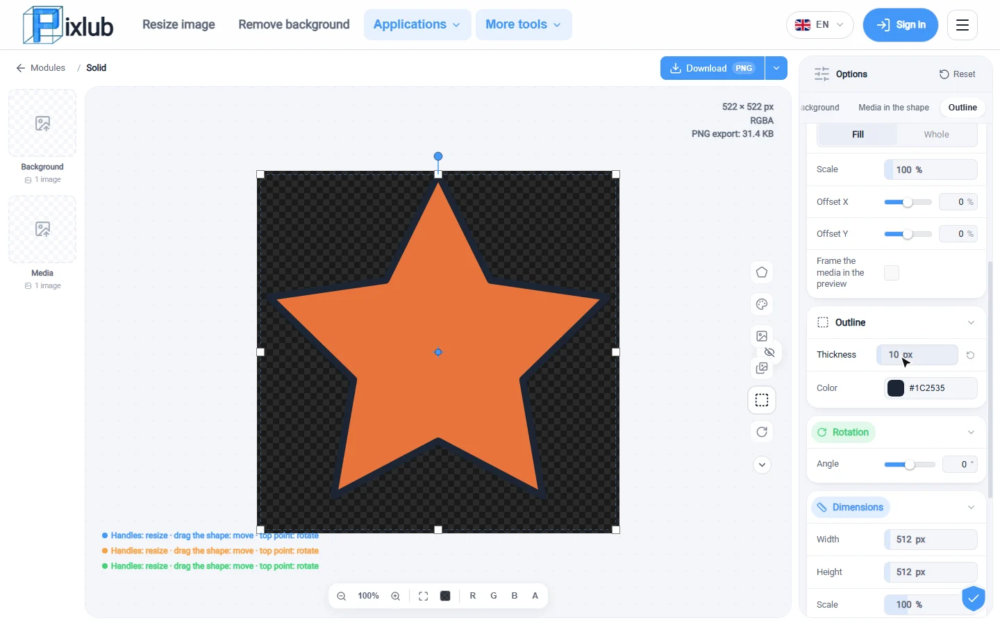

# Solid

Generate a filled shape: colour, gradient or an image inside.

**Category** : Generation · **Identifier** : `solid` · [API reference](./api.md)

## Where to use it

- **[Module page](https://pixlub.com/en/module/solid)** : Drop your files, adjust, download: the module on its own, nothing else.
- **[Image graph](https://pixlub.com/en/image/graph)** : Connect it to other modules to build a richer effect.

## Inputs

The files the module page accepts: drop them on the import area, or click it to browse. A file in another format is set aside, with a message listing the allowed formats.

| Input | Accepted formats | Files |
| --- | --- | --- |
| **Background** (optional) Optional image placed under the shape; when connected, it also sets the size of the result. | `PNG`, `JPEG`, `WebP`, `GIF`, `AVIF`, `BMP` | One file |
| **Media** (optional) Optional image seen through the shape, instead of its colour; the outline stays on top. | `PNG`, `JPEG`, `WebP`, `GIF`, `AVIF`, `BMP` | One file |

Through the API, the files and their formats are detailed in the [API view](./api.md).

## Video walkthrough

▶ [Watch the video](../../../../assets/modules/solid/demo.en.mp4) : Shape, colour, outline, moving, then an image inside the shape.

1. `0:00` The render shows right away
2. `0:01` Pick the shape
3. `0:05` Colour
4. `0:10` Add an outline
5. `0:13` Move and rotate with the mouse
6. `0:17` An image inside the shape
7. `0:20` Export the result

## How to use

1. **Pick the shape**

   Rectangle, circle, ellipse, ring, triangle, diamond, polygon or star.

2. **Colour it**

   Solid colour or gradient, optional outline.

3. **Place it**

   In the preview: drag to move, pull the handles, the top point to rotate.

## Settings

| Setting | Effect |
| --- | --- |
| **Shape** | With its own settings: roundness, ring thickness, sides, points. |
| **Color** / **Inner filling** | Colour or gradient; fade from the center. |
| **Background** | Optional image under the shape; it sets the result size. |
| **Media in the shape** | Image seen through the shape: fill or whole, scale, offset. |
| **Outline** | Thickness and colour. |
| **Dimensions**, **Position**, **Rotation** | Zone size and shape placement. |

## Tips

- A photo in a circle makes an avatar in one step.
- A double-click on the shape switches to framing the media in the preview.

## Export

The **Download** button saves the result in the format of the imported file: a JPEG photo comes out as JPEG. The menu on its right opens the **Export settings** to pick another format, set the quality, size or background, and offers **Copy image**.

- **[The export dialog](../../../../01-app/en/02-image/04-exportation.md)** : Every format, its settings, local or server processing, batches and the local folder.
