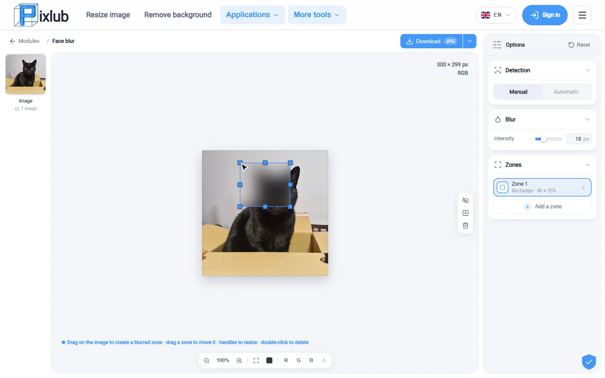

# Face blur

Blur hand-drawn zones, or the faces detected by AI.

**Category** : API services · **Identifier** : `faceBlurApi` · [API reference](./api.md)

## Where to use it

- **[Module page](https://pixlub.com/en/module/faceBlurApi)** : Drop your files, adjust, download: the module on its own, nothing else.
- **[Image graph](https://pixlub.com/en/image/graph)** : Connect it to other modules to build a richer effect.

## Inputs

The files the module page accepts: drop them on the import area, or click it to browse. A file in another format is set aside, with a message listing the allowed formats.

| Input | Accepted formats | Files |
| --- | --- | --- |
| **Image** (required) Image whose zones are blurred. In automatic mode, it is sent to the server to detect the faces. | `PNG`, `JPEG`, `WebP` | One file |

Through the API, the files and their formats are detailed in the [API view](./api.md).

## Video walkthrough

▶ [Watch the video](../../../../assets/modules/faceBlurApi/demo.en.mp4) : Draw a zone, move it, set the intensity.

1. `0:00` Import a photo
2. `0:03` Draw a zone to blur
3. `0:06` Move the zone
4. `0:09` Blur intensity
5. `0:13` Export the result

## How to use

1. **Import**

   Drop a photo.

2. **Manual mode**

   Drag on the preview to draw a zone; drag it to move it, pull its handles, double-click to delete it.

3. **Or automatic mode**

   Faces are detected by our servers (account and credits); the zones stay editable afterwards.

## Settings

| Setting | Effect |
| --- | --- |
| **Mode** | **Manual** (local, free) or **Automatic** (AI detection). |
| **Intensity** | 1 to 60 px of blur. |
| **Zones** | The list of blurred zones. |

## Tips

- In manual mode, nothing leaves your browser: the badge stays on "Local processing".

## Export

The **Download** button saves the result in the format of the imported file: a JPEG photo comes out as JPEG. The menu on its right opens the **Export settings** to pick another format, set the quality, size or background, and offers **Copy image**.

- **[The export dialog](../../../../01-app/en/02-image/04-exportation.md)** : Every format, its settings, local or server processing, batches and the local folder.
