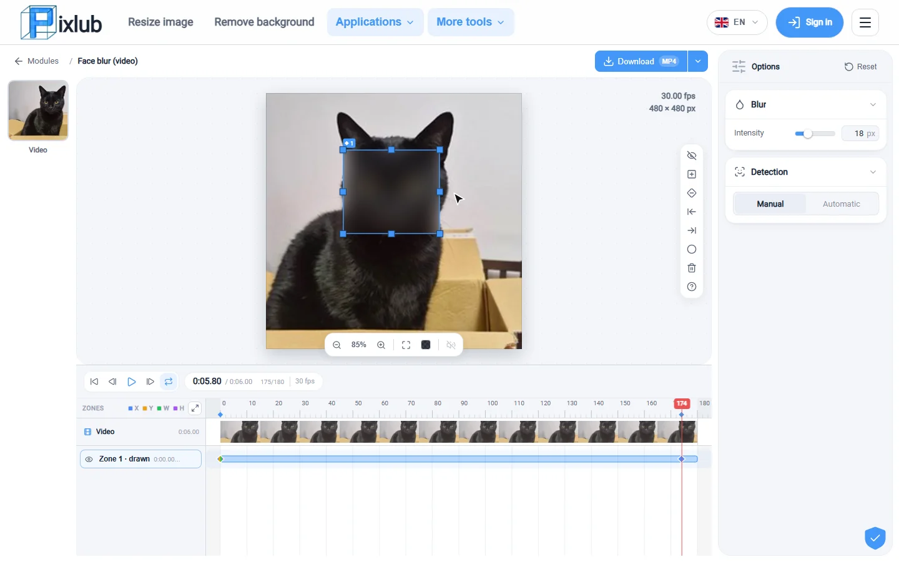

# Face blur (video)

Blur hand-drawn regions, or the faces detected on every frame of a video.

**Category** : API services · **Identifier** : `faceBlurVideoApi`

## Where to use it

- **[Module page](https://pixlub.com/en/module/faceBlurVideoApi)** : Drop your files, adjust, download: the module on its own, nothing else.
- **[Video editor](https://pixlub.com/en/video/editor)** : Add it as an effect on a clip of your edit.

## Inputs

The files the module page accepts: drop them on the import area, or click it to browse. A file in another format is set aside, with a message listing the allowed formats.

| Input | Accepted formats | Files |
| --- | --- | --- |
| **Video** (required) Video blurred in the browser. In automatic mode, it is sent once to the server to detect the faces. | `MP4`, `WebM`, `MOV`, `MKV` | One file |

## Video walkthrough

▶ [Watch the video](../../../../assets/modules/faceBlurVideoApi/demo.en.mp4) : Draw a zone over the face, move it back further on, play the result.

1. `0:00` Import a video
2. `0:03` Draw a zone over the face
3. `0:06` Further on, move it back: a key is set
4. `0:11` The keys in the timeline
5. `0:16` Play: the blur follows the face
6. `0:25` Blur intensity
7. `0:29` Export the result

## How to use

1. **Import**

   Drop a video: in **Manual** mode, it never leaves your device.

2. **Draw a zone**

   Drag on the preview to cover a face; the zone applies to the whole video.

3. **Make it follow**

   Further on in the video, drag the zone back onto the face: a key is set and the frames between two keys follow.

4. **Or automatic mode**

   Our servers detect the faces on every frame (account and credits); the zones stay editable afterwards.

## Settings

| Setting | Effect |
| --- | --- |
| **Mode** | **Manual** (drawn zones, everything stays local) or **Automatic** (detection by our servers). |
| **Intensity** | 1 to 60 px of blur. |
| **Working height** | Automatic: 360 to 1080 px; lower, detection is faster. |
| **Margin around faces** | Automatic: widens each detected zone to follow movement. |
| **Persistence** | Automatic: 0 to 30 frames a zone stays when the face is no longer found. |

## Tips

- In the timeline, each key is coloured by what it sets (X, Y, width, height): hover it for its values, click to type them, **Delete** removes it and <kbd>Ctrl</kbd> + <kbd>Z</kbd> undoes.
- In automatic mode, raise the **persistence** if a blur flickers when someone turns their head.

## Export

The result is exported from the module page or the video editor, as MP4, WebM or another video container, without leaving your browser.

- **[The video editor](../../../../01-app/en/03-video/01-video-editor.md)** : Edit, tune the effects and export a video.
