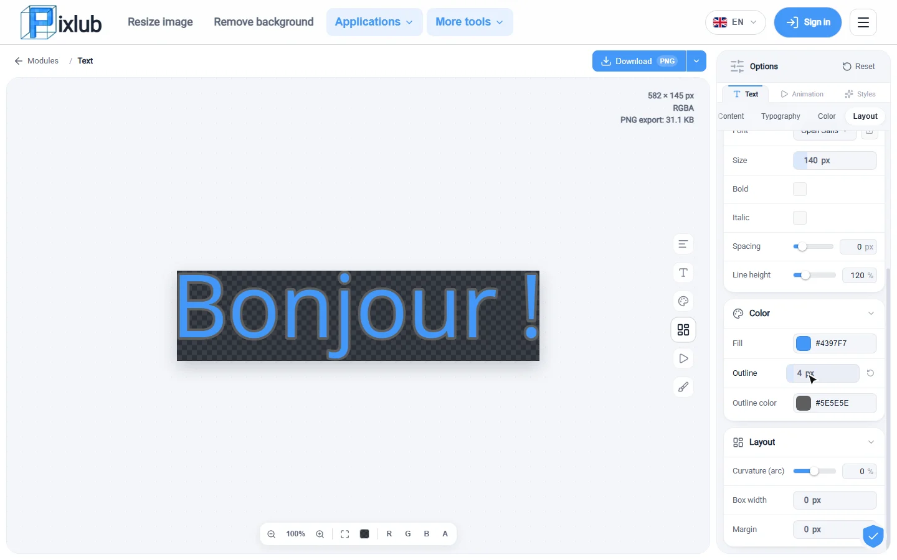

# Text

Compose text: font, colour or gradient, styles and animation.

**Category** : Text · **Identifier** : `text`

## Where to use it

- **[Module page](https://pixlub.com/en/module/text)** : Drop your files, adjust, download: the module on its own, nothing else.
- **[Image graph](https://pixlub.com/en/image/graph)** : Connect it to other modules to build a richer effect.

## Inputs

This module has no input: it creates the image from its settings alone.

## Video walkthrough

▶ [Watch the video](../../../../assets/modules/text/demo.en.mp4) : Write, size, colour, outline, curvature.

1. `0:00` The text shows right away
2. `0:01` Write the text
3. `0:04` Size, colour and outline
4. `0:15` Curve the text
5. `0:19` Export the result

## How to use

1. **Write**

   Type the text in **Content**; line breaks are typed directly.

2. **Format it**

   Font, size, bold, spacing, colour or gradient, outline, curvature.

3. **Animate or style**

   The **Animation** tab makes the text appear, the **Styles** tab stacks effects on the text.

## Settings

| Setting | Effect |
| --- | --- |
| **Content** | Text, alignment and case. |
| **Typography** | Font (or your own, imported), size, bold, italic, spacing, line height. |
| **Color** | Solid or gradient fill, outline. |
| **Layout** | Arc curvature, box width (wrapping), margin. |
| **Animation** | An animated entrance (fade, bounce, typewriter…), with duration and delay. |
| **Styles** | A stack of effects laid on the text. |

## Tips

- Export to PNG for cut-out text, to GIF or APNG for an animation.
- The **preset** at the top of the panel gives a full style in one click.

## Export

The **Download** button saves the result in the format of the imported file: a JPEG photo comes out as JPEG. The menu on its right opens the **Export settings** to pick another format, set the quality, size or background, and offers **Copy image**.

- **[The export dialog](../../../../01-app/en/02-image/04-exportation.md)** : Every format, its settings, local or server processing, batches and the local folder.
