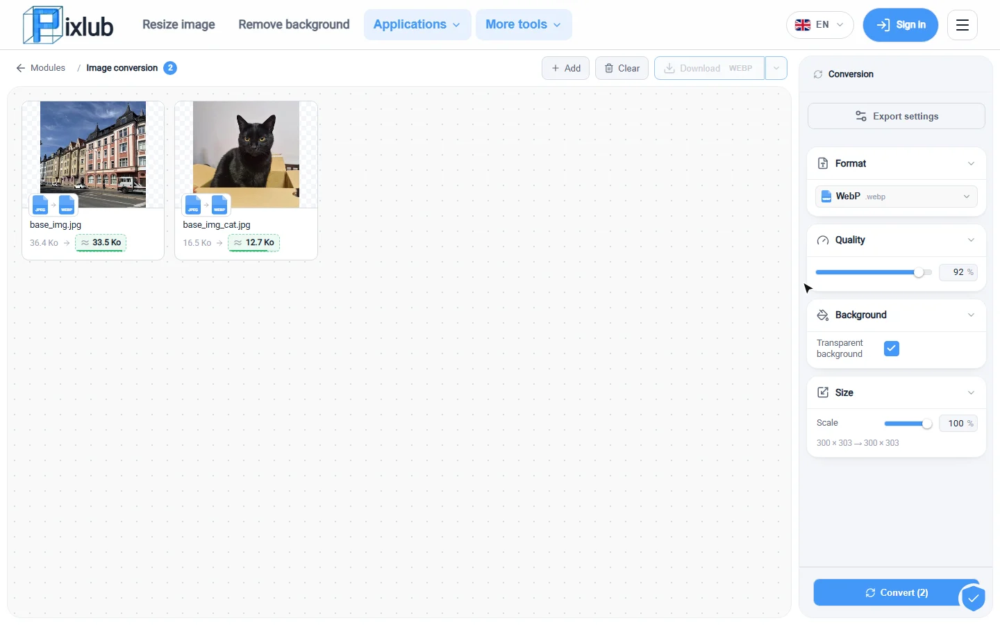

# Conversion

Convert images, videos and sounds to any export format, with the estimated size.

**Category** : Conversion · **Identifier** : `convert` · [API reference](./api.md)

## Where to use it

- **[Module page](https://pixlub.com/en/module/convert)** : Drop your files, adjust, download: the module on its own, nothing else.

## Inputs

The files the module page accepts: drop them on the import area, or click it to browse. A file in another format is set aside, with a message listing the allowed formats.

| Input | Accepted formats | Files |
| --- | --- | --- |
| **Image(s)** (required) Image(s) to convert to the chosen format. | `PNG`, `JPEG`, `WebP`, `GIF`, `AVIF`, `BMP` | One or more: each image is processed on its own, with the same settings |

How many images are processed at once depends on your plan.

Through the API, the files and their formats are detailed in the [API view](./api.md).

## Video walkthrough

▶ [Watch the video](../../../../assets/modules/convert/demo.en.mp4) : Import, pick the format, the scale, then convert.

1. `0:00` Import images
2. `0:03` Pick the format
3. `0:07` Scale and estimated size
4. `0:11` Convert

## How to use

1. **Import**

   Drop your images; each card shows the original format, the new one and the estimated size.

2. **Pick the format**

   The **Format** menu offers the whole export catalog; **Export settings** opens its options.

3. **Convert**

   **Convert** runs the batch.

## Settings

| Setting | Effect |
| --- | --- |
| **Format** | PNG, JPEG, WebP, AVIF… Formats computed on our servers are flagged. |
| **Transparent background** | Kept if the format allows it, otherwise replaced by a colour. |
| **Scale** | Shrinks the images during conversion. |

## Tips

- The estimated size helps choose between quality and lightness before converting.
- For each format, see the [export dialog](../../../../01-app/en/02-image/04-exportation.md).

## Export

The **Download** button saves the result in the format of the imported file: a JPEG photo comes out as JPEG. The menu on its right opens the **Export settings** to pick another format, set the quality, size or background, and offers **Copy image**.

This module sets the format of the file itself, from its settings: PNG, JPEG, WebP.

With several images, the button becomes **ZIP download**; the menu also offers separate files, or only the image on display.

- **[The export dialog](../../../../01-app/en/02-image/04-exportation.md)** : Every format, its settings, local or server processing, batches and the local folder.
