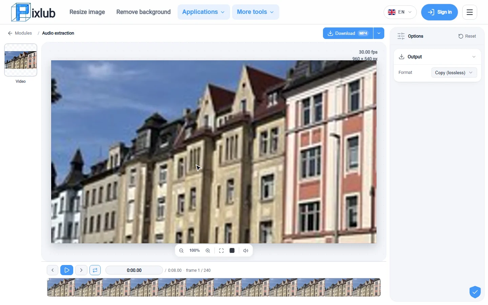

# Audio extraction

Pull a video's soundtrack out into an audio file.

**Category** : Conversion · **Identifier** : `extractAudioVideo`

## Where to use it

- **[Module page](https://pixlub.com/en/module/extractAudioVideo)** : Drop your files, adjust, download: the module on its own, nothing else.
- **[Video editor](https://pixlub.com/en/video/editor)** : Add it as an effect on a clip of your edit.

## Inputs

The files the module page accepts: drop them on the import area, or click it to browse. A file in another format is set aside, with a message listing the allowed formats.

| Input | Accepted formats | Files |
| --- | --- | --- |
| **Video** (required) Video whose audio track is extracted. | `MP4`, `WebM`, `MOV`, `MKV` | One file |

## Video walkthrough

▶ [Watch the video](../../../../assets/modules/extractAudioVideo/demo.en.mp4) : Import a video, pick the audio format.

1. `0:00` Import a video
2. `0:05` Pick the audio format
3. `0:09` Export the result

## How to use

1. **Import**

   Drop one or more videos with sound: each gets its own workspace.

2. **Keep a part**

   Drag the timeline handles, where the waveform follows the frames.

3. **Pick the format**

   In the export window: original track, MP3, AAC, Opus, Vorbis, FLAC, WAV or AIFF.

## Settings

| Setting | Effect |
| --- | --- |
| **Start / End** | Part of the sound kept, in seconds (0 at the end = to the end). |
| **Format** (export) | Original track (lossless), MP3, AAC, Opus, Vorbis, FLAC, WAV or AIFF. |
| **Bitrate, sample rate, channels, bit depth** (export) | Depending on the chosen format. |

## Tips

- The **original track** is instant and lossless: prefer it when its format suits you.
- FLAC keeps all the sound at about half the size of WAV.

## Export

The result is exported from the module page or the video editor, as MP4, WebM or another video container, without leaving your browser.

- **[The video editor](../../../../01-app/en/03-video/01-video-editor.md)** : Edit, tune the effects and export a video.
