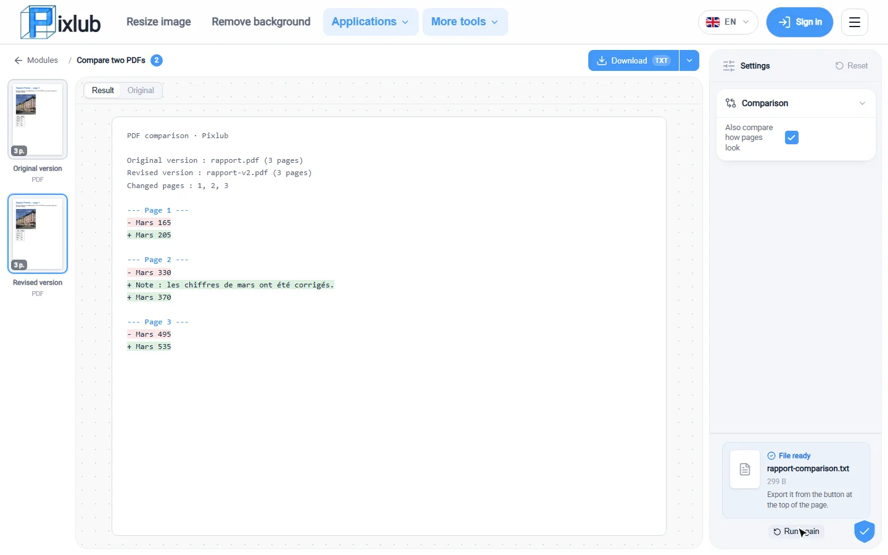

# Compare two PDFs

List the lines added and removed page by page between two versions of a PDF.

**Category** : Documents · **Identifier** : `docCompare`

## Where to use it

- **[Module page](https://pixlub.com/en/module/docCompare)** : Drop your files, adjust, download: the module on its own, nothing else.

## Video walkthrough

▶ [Watch the video](../../../../assets/modules/docCompare/demo.en.mp4) : Two versions, comparison, report.

1. `0:00` Import both versions
2. `0:07` Compare
3. `0:13` Download the result

## How to use

1. **Import**

   The **original version** in the first box, the **revised version** in the second.

2. **Run**

   The report lists, page by page, the removed (−) and added (+) lines.

## Settings

| Setting | Effect |
| --- | --- |
| **Also compare how pages look** | Flags pages with identical text but a different layout. Slower. |

## Tips

- The report downloads as text, to attach to a review.
