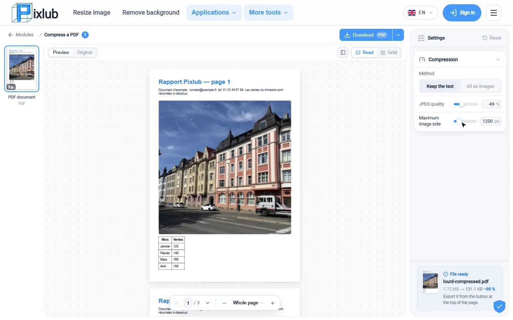

# Compress a PDF

Shrink a PDF by re-encoding its images; the text stays sharp.

**Category** : Documents · **Identifier** : `docCompress`

## Where to use it

- **[Module page](https://pixlub.com/en/module/docCompress)** : Drop your files, adjust, download: the module on its own, nothing else.

## Video walkthrough

▶ [Watch the video](../../../../assets/modules/docCompress/demo.en.mp4) : Image quality and size, then all as images.

1. `0:00` Import a heavy PDF
2. `0:03` Image quality and size
3. `0:13` All as images
4. `0:18` Download the result

## How to use

1. **Import**

   Drop a PDF; its size shows.

2. **Adjust**

   Image **JPEG quality** and **maximum side**.

3. **Run**

   The new size shows before downloading.

## Settings

| Setting | Effect |
| --- | --- |
| **Method** | **Keep the text** (images re-encoded) or **All as images** (each page as JPEG). |
| **JPEG quality** | 30 to 95%. |
| **Maximum image side** | 300 to 6000 px. |
| **Page resolution** | All as images: 72 to 300 dpi. |

## Tips

- **All as images** shrinks scans the most, but the text is no longer selectable.
