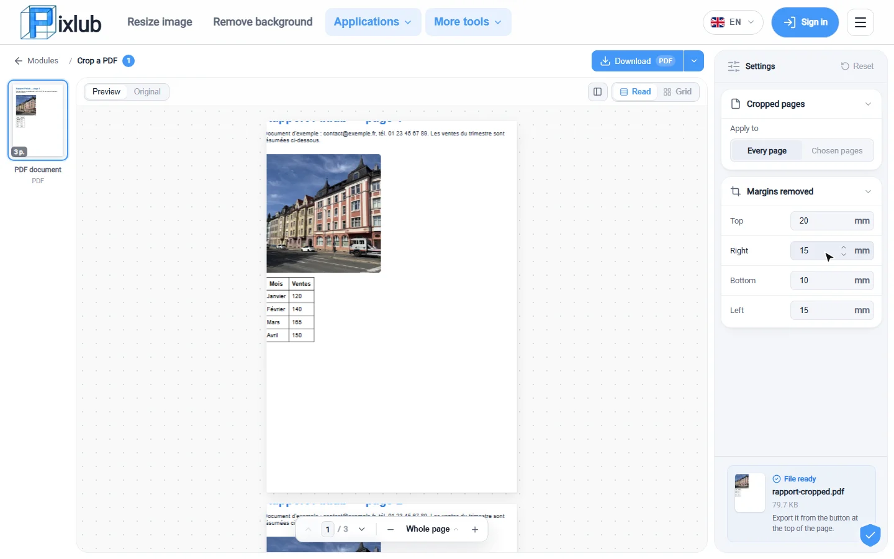

# Crop a PDF

Trim a margin around the pages, without touching their content.

**Category** : Documents · **Identifier** : `docCrop`

## Where to use it

- **[Module page](https://pixlub.com/en/module/docCrop)** : Drop your files, adjust, download: the module on its own, nothing else.

## Video walkthrough

▶ [Watch the video](../../../../assets/modules/docCrop/demo.en.mp4) : Margins removed, then cropping page by page.

1. `0:00` Import a PDF
2. `0:03` Margins removed
3. `0:14` Or page by page
4. `0:17` Download the result

## How to use

1. **Import**

   Drop a PDF.

2. **Set the margins**

   Top, right, bottom, left, in millimetres.

3. **Or page by page**

   **Chosen pages** gives specific margins to each group of pages.

## Settings

| Setting | Effect |
| --- | --- |
| **Apply to** | Every page, or chosen pages. |
| **Top** / **Right** / **Bottom** / **Left** | 0 to 500 mm. |
| **Crops** | Chosen pages mode: one row per group of pages. |

## Tips

- Cropped content is only hidden: to truly remove text, use [Redact](../docRedact/README.md).
