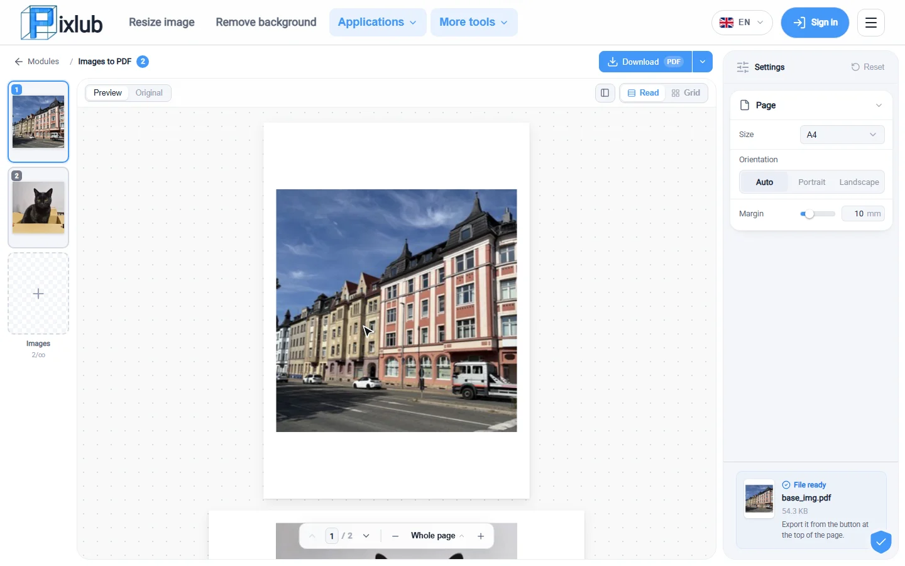

# Images to PDF

Combine images into a PDF, one image per page.

**Category** : Documents · **Identifier** : `docImagesToPdf`

## Where to use it

- **[Module page](https://pixlub.com/en/module/docImagesToPdf)** : Drop your files, adjust, download: the module on its own, nothing else.

## Video walkthrough

▶ [Watch the video](../../../../assets/modules/docImagesToPdf/demo.en.mp4) : Import images, page size, margin.

1. `0:00` Import images
2. `0:03` Page size
3. `0:09` Margin
4. `0:15` Download the result

## How to use

1. **Import**

   Drop your images (PNG, JPEG, WebP); reorder them in the list.

2. **Pick the page**

   A4, A3, A5, US Letter… or the size of each image.

3. **Run**

   One PDF, one image per page.

## Settings

| Setting | Effect |
| --- | --- |
| **Size** | Image size, A4, A3, A5, US Letter or US Legal. |
| **Orientation** | Automatic, portrait or landscape. |
| **Margin** | 0 to 50 mm around each image. |

## Tips

- Automatic orientation: each page follows its image's direction.
