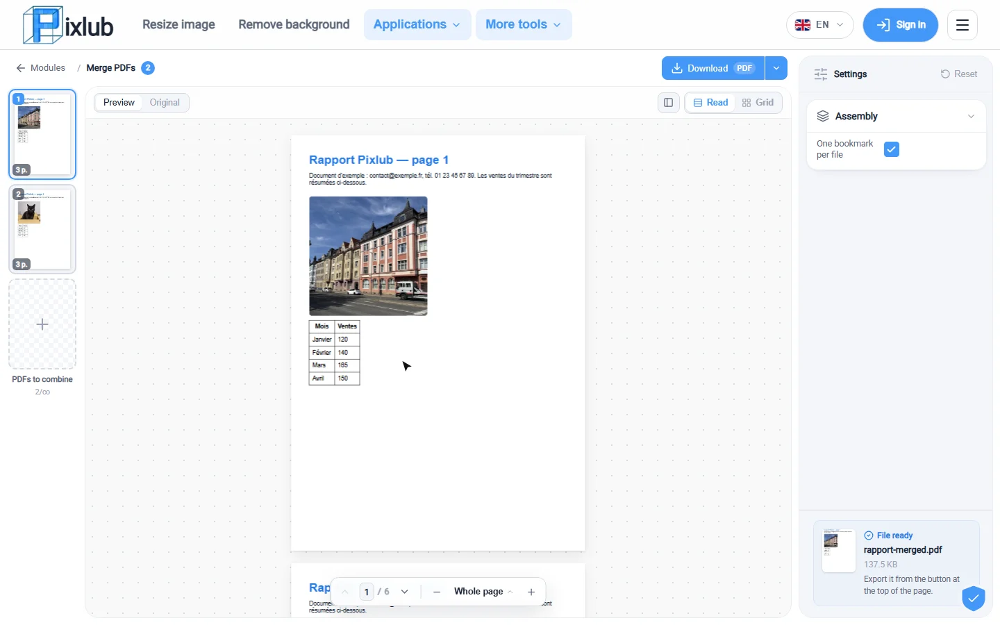

# Merge PDFs

Combine several PDFs into a single file, in the order you choose.

**Category** : Documents · **Identifier** : `docMerge`

## Where to use it

- **[Module page](https://pixlub.com/en/module/docMerge)** : Drop your files, adjust, download: the module on its own, nothing else.

## Video walkthrough

▶ [Watch the video](../../../../assets/modules/docMerge/demo.en.mp4) : Import several PDFs, bookmarks, page grid.

1. `0:00` Import several PDFs
2. `0:03` One bookmark per file
3. `0:13` Download the result

## How to use

1. **Import**

   Drop at least two PDFs; reorder them in the list.

2. **Check**

   The **Grid** view shows every page in a row.

3. **Download**

   A single PDF, in the list order.

## Settings

| Setting | Effect |
| --- | --- |
| **One bookmark per file** | Adds a bookmark at the start of each document, named after its file. |

## Tips

- To keep only some pages afterwards, use [Organize pages](../docPages/README.md).
