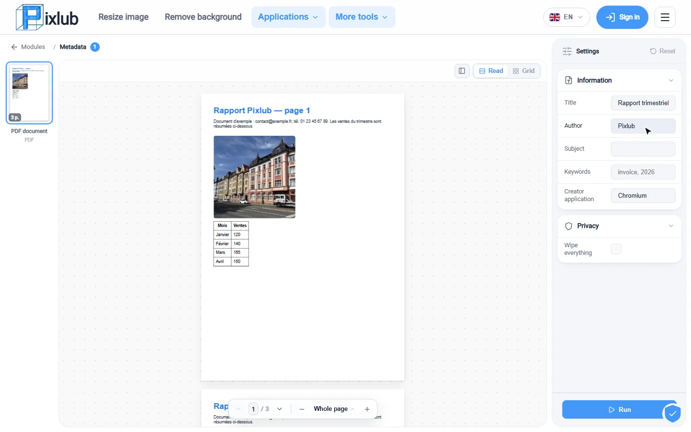

# Metadata

Read and edit the title, author, subject and keywords of a PDF, or wipe them.

**Category** : Documents · **Identifier** : `docMetadata`

## Where to use it

- **[Module page](https://pixlub.com/en/module/docMetadata)** : Drop your files, adjust, download: the module on its own, nothing else.

## Video walkthrough

▶ [Watch the video](../../../../assets/modules/docMetadata/demo.en.mp4) : Edit title and author, or wipe everything.

1. `0:00` Import a PDF
2. `0:03` Edit title and author
3. `0:13` Or wipe everything
4. `0:22` Download the result

## How to use

1. **Import**

   Drop a PDF: its current metadata fills the fields.

2. **Edit**

   Title, author, subject, keywords, creator application.

3. **Or wipe everything**

   Before sharing a file, to leave nothing behind.

## Settings

| Setting | Effect |
| --- | --- |
| **Title**, **Author**, **Subject**, **Keywords**, **Creator application** | Document information. |
| **Wipe everything** | Also removes the producer, the dates and the XMP metadata. |

## Tips

- The title shows in the browser tab when the PDF is opened.
