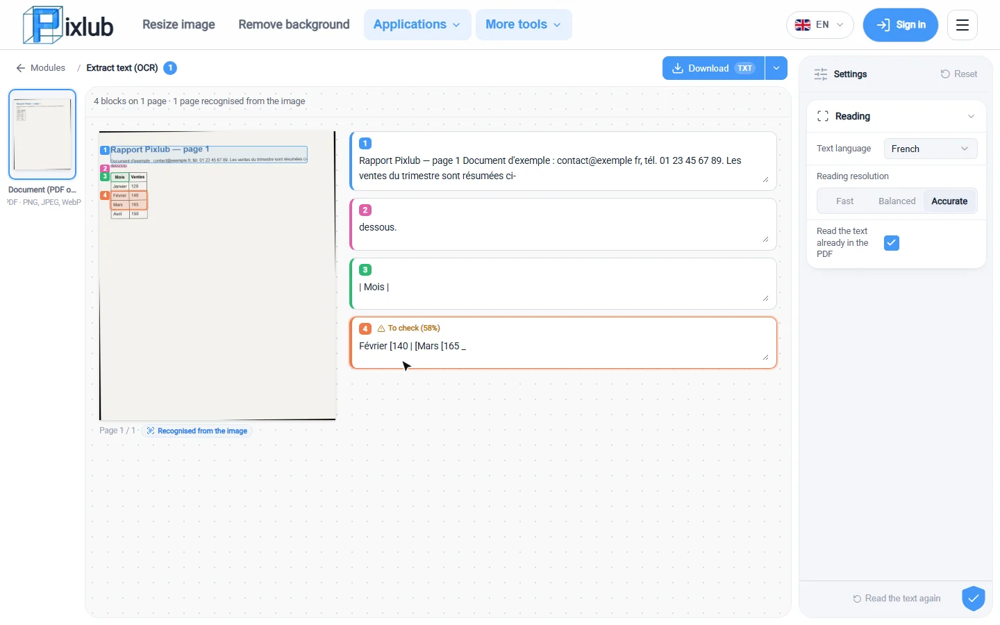

# Extract text (OCR)

Read the text of a PDF, a scan or a document photo.

**Category** : Documents · **Identifier** : `docOcrText`

## Where to use it

- **[Module page](https://pixlub.com/en/module/docOcrText)** : Drop your files, adjust, download: the module on its own, nothing else.

## Video walkthrough

▶ [Watch the video](../../../../assets/modules/docOcrText/demo.en.mp4) : Imported scan, blocks to review, language and resolution.

1. `0:00` Import a scan
2. `0:06` Review the blocks
3. `0:08` Language and resolution
4. `0:14` Download the result

## How to use

1. **Import**

   A PDF, a scan or a photo (PNG, JPEG, WebP).

2. **Review**

   The text shows block by block; doubtful blocks are flagged "To review" and are fixed in place.

3. **Download**

   As plain text or as a searchable PDF.

## Settings

| Setting | Effect |
| --- | --- |
| **Text language** | Improves the recognition of accents and words. |
| **Reading resolution** | Fast, balanced or precise (300 dpi). |
| **Read the text already in the PDF** | A page that already holds its text is read as is, without errors. |

## Tips

- Recognition runs in your browser: the document is not uploaded.
