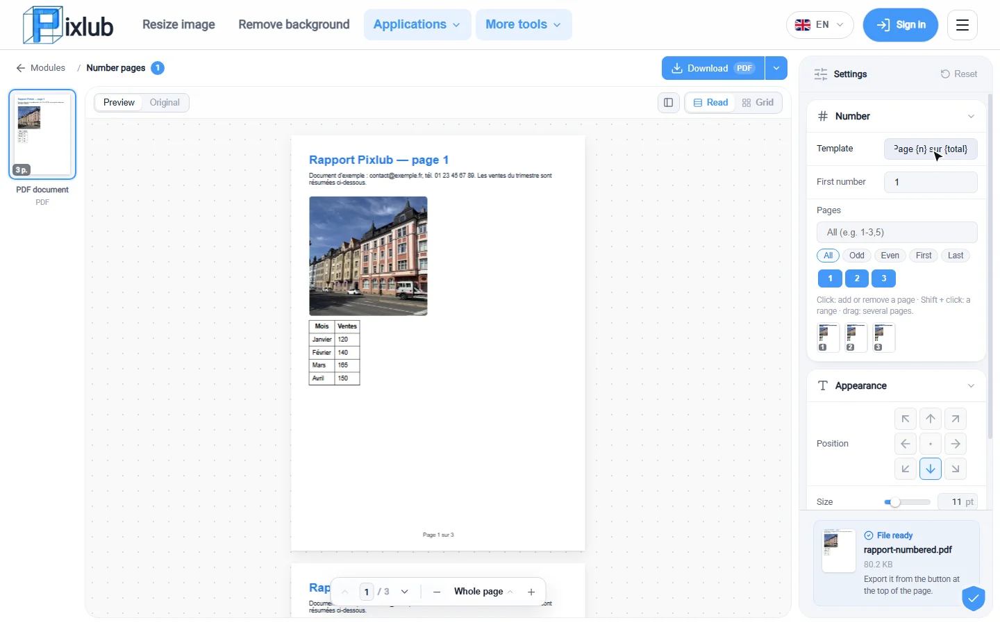

# Number pages

Add a number to each page, where and how you want it.

**Category** : Documents · **Identifier** : `docPageNumbers`

## Where to use it

- **[Module page](https://pixlub.com/en/module/docPageNumbers)** : Drop your files, adjust, download: the module on its own, nothing else.

## Video walkthrough

▶ [Watch the video](../../../../assets/modules/docPageNumbers/demo.en.mp4) : Number template, position and size.

1. `0:00` Import a PDF
2. `0:03` Number template
3. `0:13` Position and size
4. `0:21` Download the result

## How to use

1. **Import**

   Drop a PDF.

2. **Write the template**

   `{n}` is the number, `{total}` the page count: `Page {n} of {total}`.

3. **Place it**

   Position, size, margin and colour.

## Settings

| Setting | Effect |
| --- | --- |
| **Template** | Text with `{n}` and `{total}`. |
| **First number** | Number of the first numbered page. |
| **Pages** | Pages that get a number. |
| **Position** / **Size** / **Margin** / **Color** | Number appearance. |

## Tips

- To skip the cover, pick pages from 2 onward and start at 2.
