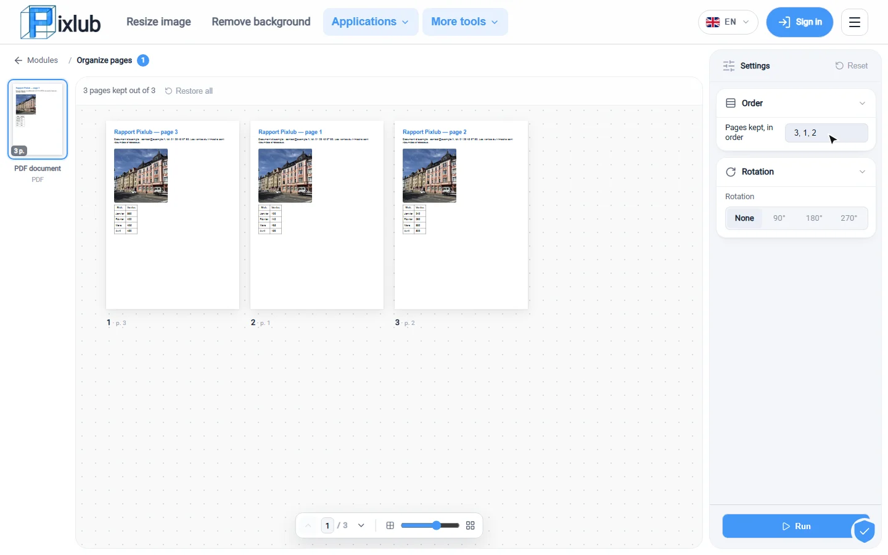

# Organize pages

Keep, delete, reorder, duplicate or rotate the pages of a PDF.

**Category** : Documents · **Identifier** : `docPages`

## Where to use it

- **[Module page](https://pixlub.com/en/module/docPages)** : Drop your files, adjust, download: the module on its own, nothing else.

## Video walkthrough

▶ [Watch the video](../../../../assets/modules/docPages/demo.en.mp4) : Reorder, then rotate pages.

1. `0:00` Import a PDF
2. `0:03` Reorder the pages
3. `0:07` Rotate pages
4. `0:13` Download the result

## How to use

1. **Import**

   Drop a PDF; the grid shows its pages.

2. **Pick the pages**

   Write the pages to keep, in order: `3, 1, 2`. A missing page is deleted, a repeated one duplicated.

3. **Rotate**

   Pick the angle and the pages it applies to.

## Settings

| Setting | Effect |
| --- | --- |
| **Pages kept, in order** | Lists and ranges: `1-3, 5, 2`. |
| **Rotation** | 0°, 90°, 180° or 270°. |
| **Rotated pages** | The pages that get the rotation. |

## Tips

- To rearrange with the mouse, open the [PDF editor](../../../../01-app/en/04-document.md#pdf-editor).
