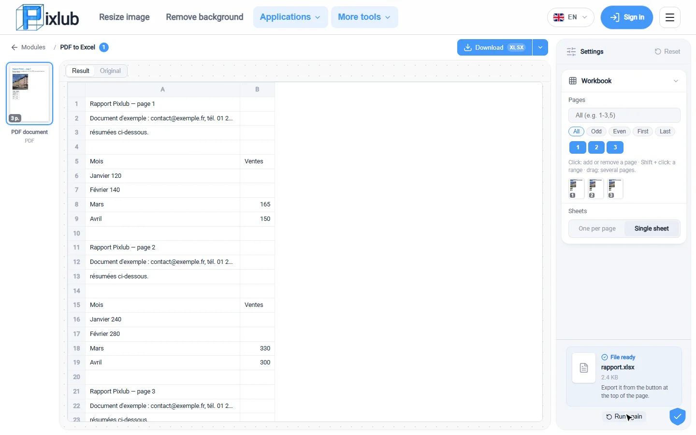

# PDF to Excel

Lay out the content of a PDF in a workbook, columns and numbers included.

**Category** : Documents · **Identifier** : `docPdfToExcel`

## Where to use it

- **[Module page](https://pixlub.com/en/module/docPdfToExcel)** : Drop your files, adjust, download: the module on its own, nothing else.

## Video walkthrough

▶ [Watch the video](../../../../assets/modules/docPdfToExcel/demo.en.mp4) : One sheet per page or a single one, then the .xlsx.

1. `0:00` Import a PDF
2. `0:03` One sheet per page, or a single one
3. `0:10` Download the result

## How to use

1. **Import**

   Drop a PDF with tables.

2. **Pick the sheets**

   One sheet per page, or a single sheet for everything.

3. **Run**

   Aligned columns become columns, numbers become numbers.

## Settings

| Setting | Effect |
| --- | --- |
| **Pages** | Pages carried over. |
| **Sheets** | One per page or a single one. |

## Tips

- Numbers are real numbers: formulas work right away.
