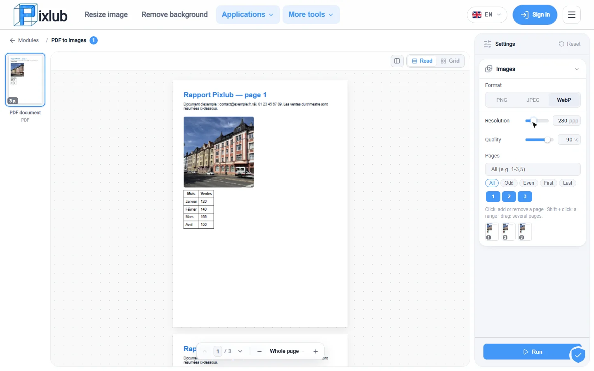

# PDF to images

Export each page of a PDF as PNG, JPEG or WebP.

**Category** : Documents · **Identifier** : `docPdfToImages`

## Where to use it

- **[Module page](https://pixlub.com/en/module/docPdfToImages)** : Drop your files, adjust, download: the module on its own, nothing else.

## Video walkthrough

▶ [Watch the video](../../../../assets/modules/docPdfToImages/demo.en.mp4) : Format and resolution, page selection.

1. `0:00` Import a PDF
2. `0:03` Format and resolution
3. `0:08` Pick the pages
4. `0:14` Download the result

## How to use

1. **Import**

   Drop a PDF.

2. **Pick the format**

   PNG, JPEG or WebP, and the **resolution**.

3. **Run**

   One image per page, in a ZIP archive.

## Settings

| Setting | Effect |
| --- | --- |
| **Format** | PNG, JPEG or WebP. |
| **Resolution** | 72 to 600 dpi. |
| **Quality** | JPEG and WebP: 30 to 100%. |
| **Pages** | All, odd, even, first, last or custom. |

## Tips

- 150 dpi is enough for screens, 300 dpi for print.
