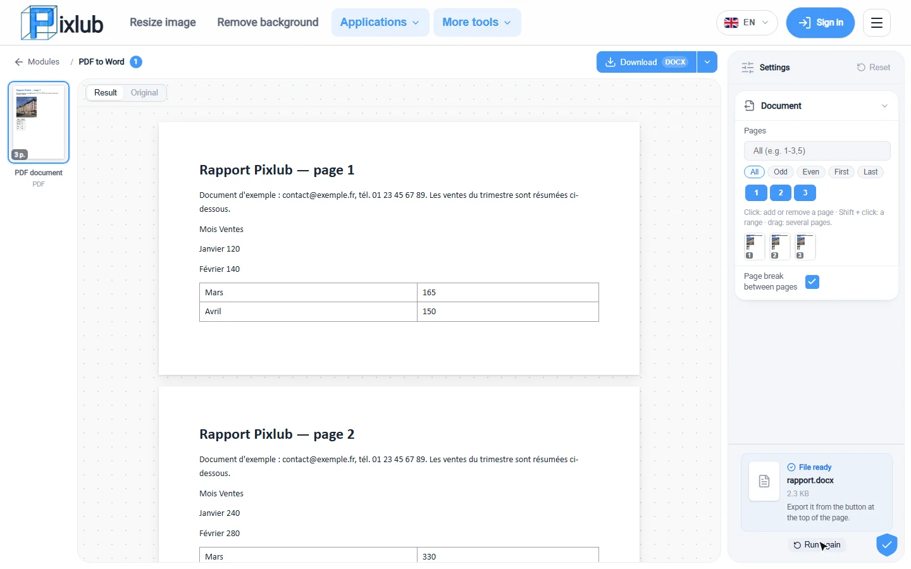

# PDF to Word

Carry the headings, paragraphs and tables of a PDF into an editable Word document.

**Category** : Documents · **Identifier** : `docPdfToWord`

## Where to use it

- **[Module page](https://pixlub.com/en/module/docPdfToWord)** : Drop your files, adjust, download: the module on its own, nothing else.

## Video walkthrough

▶ [Watch the video](../../../../assets/modules/docPdfToWord/demo.en.mp4) : Import, run, download the .docx.

1. `0:00` Import a PDF
2. `0:03` Pages and page breaks
3. `0:12` Download the result

## How to use

1. **Import**

   Drop a PDF that contains text.

2. **Run**

   Headings, paragraphs and tables carry over into a .docx.

## Settings

| Setting | Effect |
| --- | --- |
| **Pages** | Pages carried over. |
| **Page break between pages** | Keeps the PDF page layout. |

## Tips

- A scanned PDF has no text: go through [Extract text (OCR)](../docOcrText/README.md) first.
