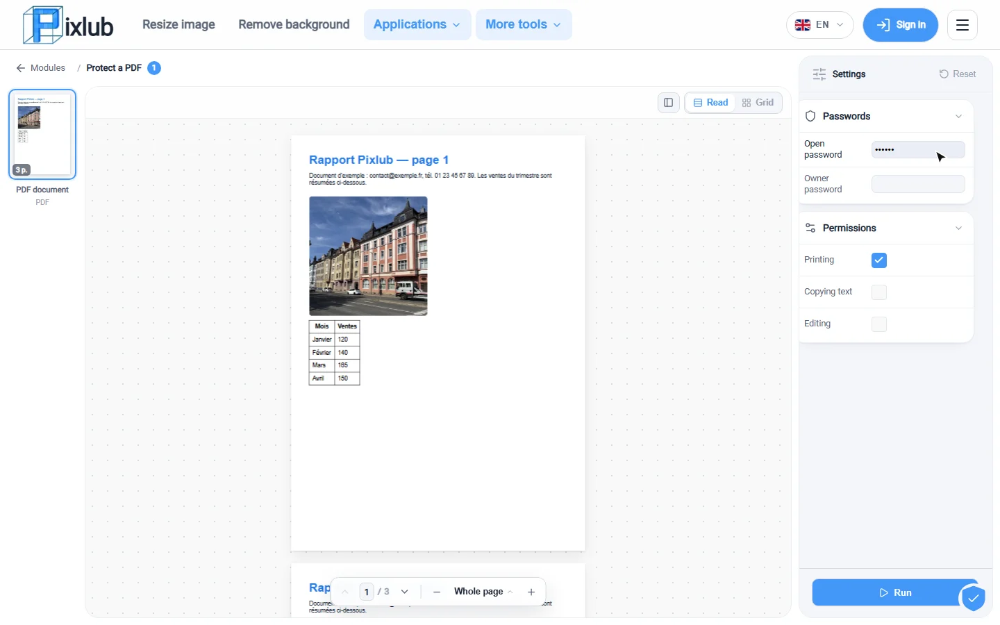

# Protect a PDF

Encrypt a PDF with a password and limit what can be done with it.

**Category** : Documents · **Identifier** : `docProtect`

## Where to use it

- **[Module page](https://pixlub.com/en/module/docProtect)** : Drop your files, adjust, download: the module on its own, nothing else.

## Video walkthrough

▶ [Watch the video](../../../../assets/modules/docProtect/demo.en.mp4) : Open password, permissions.

1. `0:00` Import a PDF
2. `0:03` Open password
3. `0:07` Permissions
4. `0:13` Download the result

## How to use

1. **Import**

   Drop a PDF.

2. **Pick the passwords**

   **Open** to read the file, **owner** to change the permissions.

3. **Set the permissions**

   Printing, copying text, editing.

## Settings

| Setting | Effect |
| --- | --- |
| **Open password** | Asked at every opening. |
| **Owner password** | Protects the permissions. |
| **Printing** / **Copying text** / **Editing** | What the reader is allowed to do. |

## Tips

- AES-256 encryption, done in your browser: the file is not uploaded.
