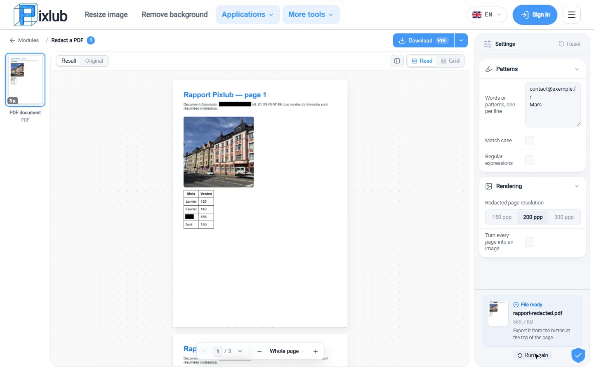

# Redact a PDF

Black out words or patterns: the text truly disappears from the page.

**Category** : Documents · **Identifier** : `docRedact`

## Where to use it

- **[Module page](https://pixlub.com/en/module/docRedact)** : Drop your files, adjust, download: the module on its own, nothing else.

## Video walkthrough

▶ [Watch the video](../../../../assets/modules/docRedact/demo.en.mp4) : Words to black out, result, before / after.

1. `0:00` Import a PDF
2. `0:03` Words to black out
3. `0:12` Before / after
4. `0:16` Download the result

## How to use

1. **Import**

   Drop a PDF.

2. **Write the words**

   One word or pattern per line: address, name, number…

3. **Run**

   Compare **Result** and **Original** before downloading.

## Settings

| Setting | Effect |
| --- | --- |
| **Words or patterns** | One per line. |
| **Match case** / **Regular expressions** | To target precisely, a phone number for instance. |
| **Redacted page resolution** | 150, 200 or 300 dpi. |
| **Turn every page into an image** | Safer when some text cannot be read; heavier file. |

## Tips

- Redacted pages become images: their text can no longer be copied.
