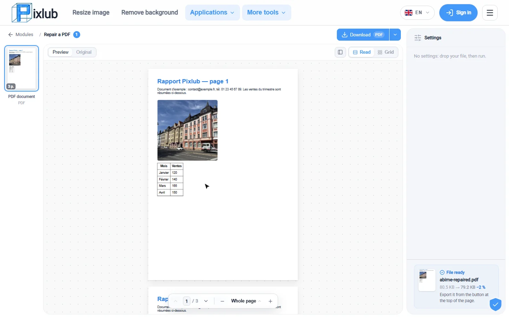

# Repair a PDF

Rebuild a damaged PDF or one that opens badly.

**Category** : Documents · **Identifier** : `docRepair`

## Where to use it

- **[Module page](https://pixlub.com/en/module/docRepair)** : Drop your files, adjust, download: the module on its own, nothing else.

## Video walkthrough

▶ [Watch the video](../../../../assets/modules/docRepair/demo.en.mp4) : Import a damaged PDF, rebuild it.

1. `0:00` Import a damaged PDF
2. `0:03` Rebuild
3. `0:07` Download the result

## How to use

1. **Import**

   Drop the troublesome PDF.

2. **Run**

   The object table, catalog and page tree are rebuilt.

## Tips

- A password-protected PDF goes through [Unlock](../docUnlock/README.md) first.
