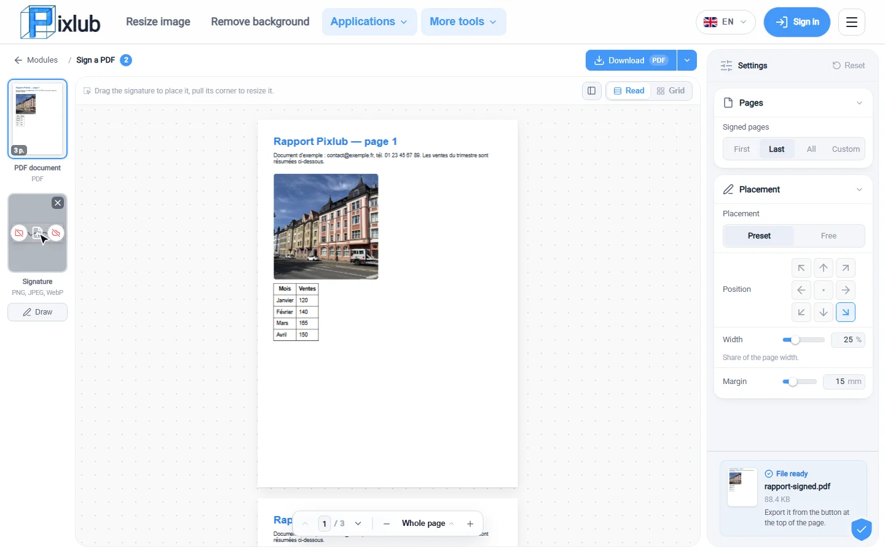

# Sign a PDF

Place your signature, drawn or imported, on the pages you choose.

**Category** : Documents · **Identifier** : `docSign`

## Where to use it

- **[Module page](https://pixlub.com/en/module/docSign)** : Drop your files, adjust, download: the module on its own, nothing else.

## Video walkthrough

▶ [Watch the video](../../../../assets/modules/docSign/demo.en.mp4) : PDF, signature, pages and position.

1. `0:00` Import a PDF
2. `0:03` Add the signature
3. `0:07` Pages and position
4. `0:15` Download the result

## How to use

1. **Import the PDF**

   In the first box.

2. **Add the signature**

   Import an image, or **Draw** with a mouse, a stylus or a finger.

3. **Place it**

   A preset position, or **Free**: drag the signature on the page, pull its corner to enlarge it.

## Settings

| Setting | Effect |
| --- | --- |
| **Signed pages** | First, last, all or custom. |
| **Placement** | Preset (position and margin) or free. |
| **Width** | 5 to 80% of the page width. |

## Tips

- This is a visual signature, not a certified electronic signature.
