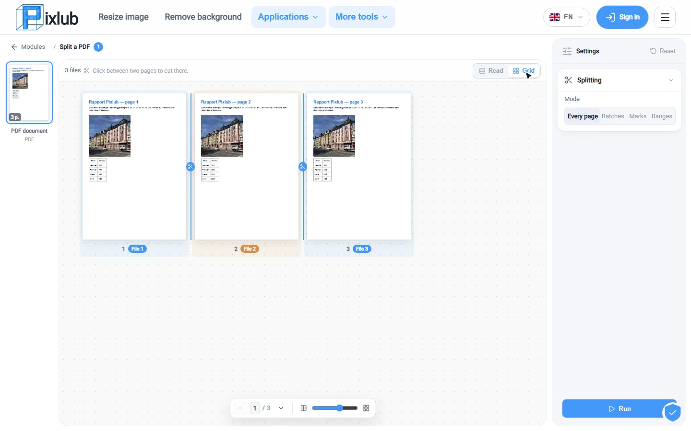

# Split a PDF

Separate a PDF into several files: by page, in batches, at marks or by ranges.

**Category** : Documents · **Identifier** : `docSplit`

## Where to use it

- **[Module page](https://pixlub.com/en/module/docSplit)** : Drop your files, adjust, download: the module on its own, nothing else.

## Video walkthrough

▶ [Watch the video](../../../../assets/modules/docSplit/demo.en.mp4) : One page per file, in batches, then by ranges.

1. `0:00` Import a PDF
2. `0:03` One page per file
3. `0:06` In batches
4. `0:10` Or by ranges
5. `0:19` Download the result

## How to use

1. **Import**

   Drop a PDF: the grid colours the future files.

2. **Pick the mode**

   **Every page**, **Batches**, **Marks** (click between two pages to cut) or **Ranges**.

3. **Run**

   The files download as a ZIP archive.

## Settings

| Setting | Effect |
| --- | --- |
| **Mode** | Every page, batches, marks or ranges. |
| **Pages per file** | Batches mode: size of each batch. |
| **Ranges** | Ranges mode: for instance `1-2, 3`. |

## Tips

- The export can also output each part as images.
