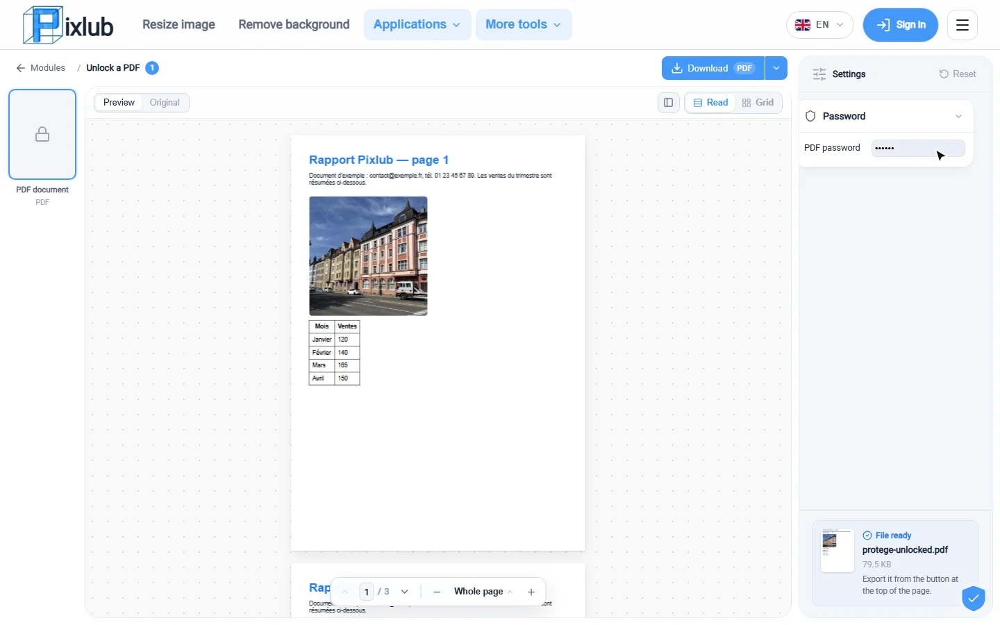

# Unlock a PDF

Remove the password and restrictions of a PDF whose password you know.

**Category** : Documents · **Identifier** : `docUnlock`

## Where to use it

- **[Module page](https://pixlub.com/en/module/docUnlock)** : Drop your files, adjust, download: the module on its own, nothing else.

## Video walkthrough

▶ [Watch the video](../../../../assets/modules/docUnlock/demo.en.mp4) : Protected PDF, password, free file.

1. `0:00` Import a protected PDF
2. `0:03` Type its password
3. `0:10` Download the result

## How to use

1. **Import**

   Drop the protected PDF.

2. **Type the password**

   Then **Run**: the PDF comes out with no password or restriction.

## Settings

| Setting | Effect |
| --- | --- |
| **PDF password** | The one that opens the file. |

## Tips

- This module does not guess a forgotten password.
