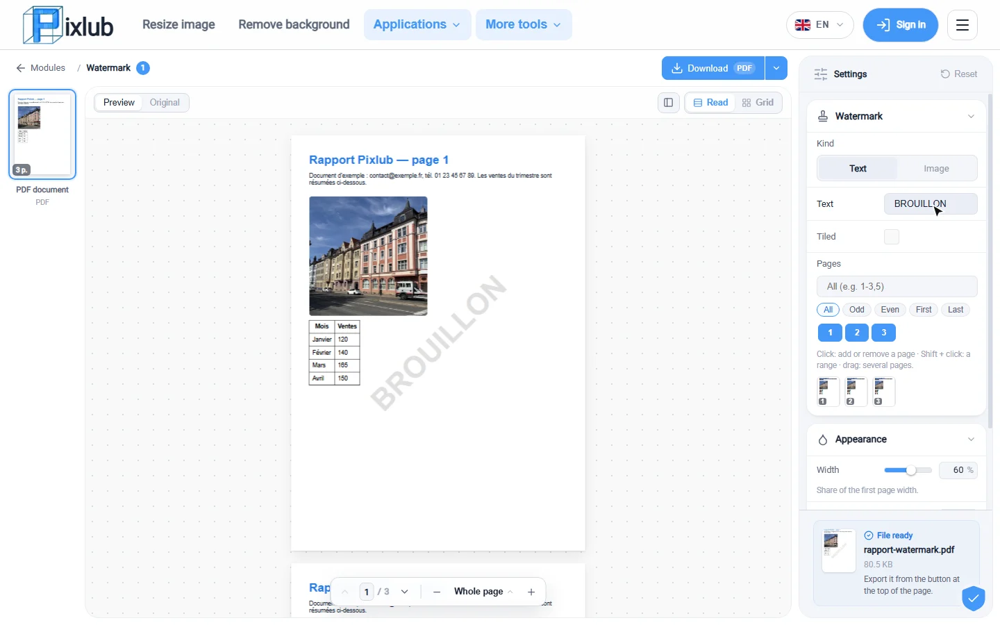

# Watermark

Lay translucent text or an image over the pages of a PDF.

**Category** : Documents · **Identifier** : `docWatermark`

## Where to use it

- **[Module page](https://pixlub.com/en/module/docWatermark)** : Drop your files, adjust, download: the module on its own, nothing else.

## Video walkthrough

▶ [Watch the video](../../../../assets/modules/docWatermark/demo.en.mp4) : Text, tiled, opacity and angle.

1. `0:00` Import a PDF
2. `0:03` Watermark text
3. `0:08` Tiled
4. `0:10` Opacity and angle
5. `0:17` Download the result

## How to use

1. **Import**

   Drop a PDF; for a logo, add the image too.

2. **Pick the watermark**

   **Text** (for instance "CONFIDENTIAL") or **Image**, once or **tiled**.

3. **Adjust**

   Width, opacity, angle and colour; the preview updates.

## Settings

| Setting | Effect |
| --- | --- |
| **Kind** | Text or image. |
| **Tiled** | Repeats the watermark across the page. |
| **Pages** | All, odd, even, first, last or custom. |
| **Width** / **Opacity** / **Angle** | 5 to 100%, 5 to 100%, −90° to 90°. |

## Tips

- A PNG with a transparent background looks best for a logo.
