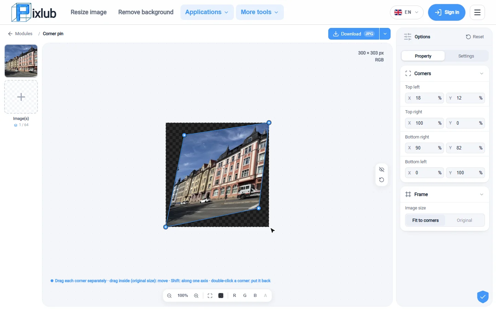

# Perspectiva

Mover libremente las cuatro esquinas de una imagen para ponerla en perspectiva.

**Categoría** : Transformación · **Identificador** : `cornerPin` · [Referencia de la API](./api.md)

## Dónde usarlo

- **[Página del módulo](https://pixlub.com/es/module/cornerPin)** : Suelte sus archivos, ajuste y descargue: el módulo por sí solo, sin nada más.
- **[Grafo de imagen](https://pixlub.com/es/image/graph)** : Conéctelo a otros módulos para componer un efecto más complejo.

## Entradas

Los archivos que acepta la página del módulo: suéltelos en la zona de importación o haga clic en ella para buscarlos. Un archivo de otro formato se descarta, con un mensaje que recuerda los formatos permitidos.

| Entrada | Formatos aceptados | Archivos |
| --- | --- | --- |
| **Imagen(es)** (obligatoria) Imagen puesta en perspectiva por sus cuatro esquinas. | `PNG`, `JPEG`, `WebP`, `GIF`, `AVIF`, `BMP` | Uno o varios: cada imagen se procesa por separado, con los mismos ajustes |

El número de imágenes que se procesan a la vez depende de su plan.

Mediante la API, los archivos y sus formatos se detallan en la [vista API](./api.md).

## Presentación en video

▶ [Ver el video](../../../../assets/modules/cornerPin/demo.en.mp4) : Tirar de las esquinas, elegir el tamaño de la imagen, restablecer una esquina.

1. `0:00` Import an image
2. `0:02` Pull the corners
3. `0:09` Image size
4. `0:14` Double-click: reset a corner
5. `0:16` Export the result

## Uso

1. **Importar**

   Suelte una o varias imágenes.

2. **Tirar de las esquinas**

   Arrastre cada esquina de la imagen en la vista previa. Arrastrar el interior mueve la imagen entera.

3. **Elegir el tamaño**

   **Ajustado a las esquinas** agranda la imagen para mostrarlo todo y **Original** conserva su tamaño y corta lo que sobresale.

## Ajustes

| Ajuste | Efecto |
| --- | --- |
| **Arriba a la izquierda**, **Arriba a la derecha**, **Abajo a la derecha**, **Abajo a la izquierda** | Posición X e Y de cada esquina, en % de la imagen (−100 a 200). |
| **Tamaño de la imagen** | **Ajustado a las esquinas** u **Original**. |

## Consejos

- **Mayús** al tirar de una esquina la mantiene en un solo eje; un **doble clic** en una esquina la devuelve a su sitio.
- Para colocar una imagen sobre una pantalla o un cartel, elija **Original** y luego ajuste las esquinas a las del soporte en el [grafo de imagen](../../../../01-app/es/02-image/01-image-graph.md).

## Exportación

El botón **Descargar** guarda el resultado en el formato del archivo importado: una foto JPEG sale en JPEG. El menú a su derecha abre los **Ajustes de exportación** para elegir otro formato y ajustar la calidad, el tamaño o el fondo, y ofrece **Copiar la imagen**.

Con varias imágenes, el botón pasa a ser **Descargar en ZIP**; el menú también ofrece los archivos por separado o solo la imagen mostrada.

- **[La ventana de exportación](../../../../01-app/es/02-image/04-exportation.md)** : Todos los formatos, sus ajustes, el procesamiento local o en el servidor, los lotes y la carpeta local.
