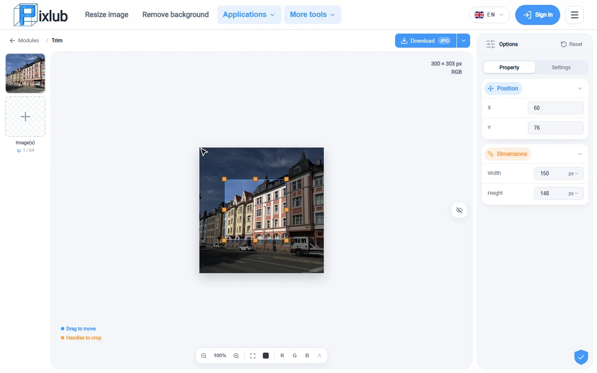

# Recortar

Conservar una zona rectangular de la imagen, con el mouse o al píxel exacto.

**Categoría** : Transformación · **Identificador** : `crop` · [Referencia de la API](./api.md)

## Dónde usarlo

- **[Página del módulo](https://pixlub.com/es/module/crop)** : Suelte sus archivos, ajuste y descargue: el módulo por sí solo, sin nada más.
- **[Grafo de imagen](https://pixlub.com/es/image/graph)** : Conéctelo a otros módulos para componer un efecto más complejo.

## Entradas

Los archivos que acepta la página del módulo: suéltelos en la zona de importación o haga clic en ella para buscarlos. Un archivo de otro formato se descarta, con un mensaje que recuerda los formatos permitidos.

| Entrada | Formatos aceptados | Archivos |
| --- | --- | --- |
| **Imagen(es)** (obligatoria) Imagen en la que se recorta la zona. | `PNG`, `JPEG`, `WebP`, `GIF`, `AVIF`, `BMP` | Uno o varios: cada imagen se procesa por separado, con los mismos ajustes |

El número de imágenes que se procesan a la vez depende de su plan.

Mediante la API, los archivos y sus formatos se detallan en la [vista API](./api.md).

## Presentación en video

▶ [Ver el video](../../../../assets/modules/crop/demo.en.mp4) : Tirar de los controladores, mover la zona, introducir un tamaño exacto.

1. `0:00` Import an image
2. `0:02` Pull the handles
3. `0:09` Move the area
4. `0:12` Type an exact size
5. `0:18` Export the result

## Uso

1. **Importar**

   Suelte una o varias imágenes.

2. **Encuadrar**

   Tire de los controladores del marco para redimensionarlo y arrastre su interior para moverlo.

3. **Ajustar al píxel**

   Introduzca **X**, **Y**, **Ancho** y **Alto** en el panel.

## Ajustes

| Ajuste | Efecto |
| --- | --- |
| **X** / **Y** | Esquina superior izquierda de la zona, en píxeles. |
| **Ancho** / **Alto** | Tamaño de la zona, en píxeles o en %. |

## Consejos

- En un lote, la misma zona se aplica a cada imagen: prefiera tamaños en **%** si las imágenes no tienen el mismo tamaño.
- Para quitar solo bordes transparentes, [Recorte automático](../trim/README.md) lo hace solo.

## Exportación

El botón **Descargar** guarda el resultado en el formato del archivo importado: una foto JPEG sale en JPEG. El menú a su derecha abre los **Ajustes de exportación** para elegir otro formato y ajustar la calidad, el tamaño o el fondo, y ofrece **Copiar la imagen**.

Con varias imágenes, el botón pasa a ser **Descargar en ZIP**; el menú también ofrece los archivos por separado o solo la imagen mostrada.

- **[La ventana de exportación](../../../../01-app/es/02-image/04-exportation.md)** : Todos los formatos, sus ajustes, el procesamiento local o en el servidor, los lotes y la carpeta local.
