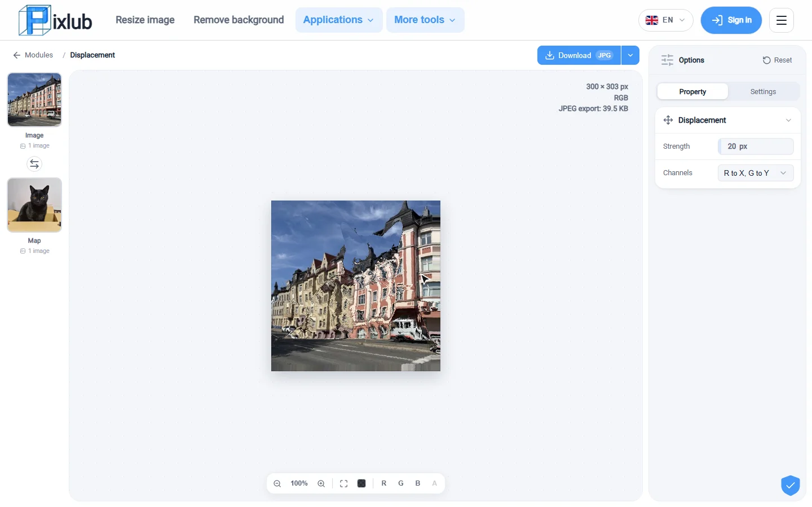

# Desplazamiento

Deformar una imagen según una segunda imagen, el mapa de desplazamiento.

**Categoría** : Transformación · **Identificador** : `displace` · [Referencia de la API](./api.md)

## Dónde usarlo

- **[Página del módulo](https://pixlub.com/es/module/displace)** : Suelte sus archivos, ajuste y descargue: el módulo por sí solo, sin nada más.
- **[Grafo de imagen](https://pixlub.com/es/image/graph)** : Conéctelo a otros módulos para componer un efecto más complejo.

## Entradas

Los archivos que acepta la página del módulo: suéltelos en la zona de importación o haga clic en ella para buscarlos. Un archivo de otro formato se descarta, con un mensaje que recuerda los formatos permitidos.

| Entrada | Formatos aceptados | Archivos |
| --- | --- | --- |
| **Imagen** (obligatoria) Imagen deformada. | `PNG`, `JPEG`, `WebP`, `GIF`, `AVIF`, `BMP` | Un archivo |
| **Mapa** (obligatoria) Imagen de referencia para el desplazamiento de los píxeles. | `PNG`, `JPEG`, `WebP`, `GIF`, `AVIF`, `BMP` | Un archivo |

Mediante la API, los archivos y sus formatos se detallan en la [vista API](./api.md).

## Presentación en video

▶ [Ver el video](../../../../assets/modules/displace/demo.en.mp4) : Imagen, mapa, fuerza y canales.

1. `0:00` Import an image
2. `0:02` Add the map
3. `0:04` Displacement strength
4. `0:08` Channels read from the map
5. `0:12` Export the result

## Uso

1. **Importar la imagen**

   Suelte la imagen que deformar en la casilla **Imagen**.

2. **Añadir el mapa**

   Suelte una segunda imagen en la casilla **Mapa**: sus colores deciden el desplazamiento de cada píxel.

3. **Dosificar**

   Ajuste la **fuerza** y luego los **canales** que se leen en el mapa.

## Ajustes

| Ajuste | Efecto |
| --- | --- |
| **Fuerza** | Desplazamiento máximo, 0 a 500 px. |
| **Canales** | **R a X, G a Y**: el rojo empuja a lo ancho y el verde, a lo alto. **Luminancia**: la luminosidad empuja en ambos ejes. |

## Consejos

- Un mapa de ruido o de nubes da un efecto de vidrio esmerilado o de calor.
- Un mapa desenfocado deforma con suavidad; un mapa nítido crea quiebres.

## Exportación

El botón **Descargar** guarda el resultado en el formato del archivo importado: una foto JPEG sale en JPEG. El menú a su derecha abre los **Ajustes de exportación** para elegir otro formato y ajustar la calidad, el tamaño o el fondo, y ofrece **Copiar la imagen**.

- **[La ventana de exportación](../../../../01-app/es/02-image/04-exportation.md)** : Todos los formatos, sus ajustes, el procesamiento local o en el servidor, los lotes y la carpeta local.
