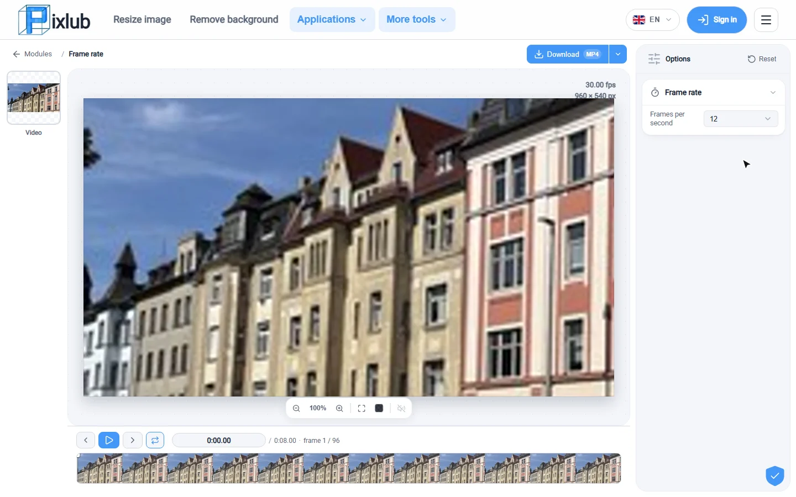

# Velocidad de fotogramas

Cambiar el número de fotogramas por segundo de un video.

**Categoría** : Transformación · **Identificador** : `frameRateVideo`

## Dónde usarlo

- **[Página del módulo](https://pixlub.com/es/module/frameRateVideo)** : Suelte sus archivos, ajuste y descargue: el módulo por sí solo, sin nada más.
- **[Editor de video](https://pixlub.com/es/video/editor)** : Añádalo como efecto en un clip del montaje.

## Entradas

Los archivos que acepta la página del módulo: suéltelos en la zona de importación o haga clic en ella para buscarlos. Un archivo de otro formato se descarta, con un mensaje que recuerda los formatos permitidos.

| Entrada | Formatos aceptados | Archivos |
| --- | --- | --- |
| **Video** (obligatoria) Video cuya velocidad de fotogramas se reescribe. | `MP4`, `WebM`, `MOV`, `MKV` | Un archivo |

## Presentación en video

▶ [Ver el video](../../../../assets/modules/frameRateVideo/demo.en.mp4) : Bajar a 12 fps y luego volver a 25 fps.

1. `0:00` Import a video
2. `0:03` Lower the frame rate: 12 fps
3. `0:13` Standard frame rate: 25 fps
4. `0:21` Export the result

## Uso

1. **Importar**

   Suelte un video. Su velocidad de fotogramas se muestra arriba a la derecha de la vista previa.

2. **Elegir la velocidad de fotogramas**

   Reproduzca la vista previa para juzgar la fluidez.

## Ajustes

| Ajuste | Efecto |
| --- | --- |
| **Fotogramas por segundo** | **Origen** (sin cambios), o 12, 15, 24, 25, 30, 50, 60 fps. |

Bajar la velocidad de fotogramas aligera el archivo; subirla por encima del origen duplica fotogramas sin añadir fluidez.

## Consejos

- 12 o 15 fps bastan para un GIF o una vista previa ligera.
- 24 fps da un aspecto «de cine», y 25 o 30 fps, el del video clásico.

## Exportación

El resultado se exporta desde la página del módulo o desde el editor de video, en MP4, WebM u otro contenedor de video, sin salir de su navegador.

- **[El editor de video](../../../../01-app/es/03-video/01-video-editor.md)** : Editar, ajustar los efectos y exportar un video.
