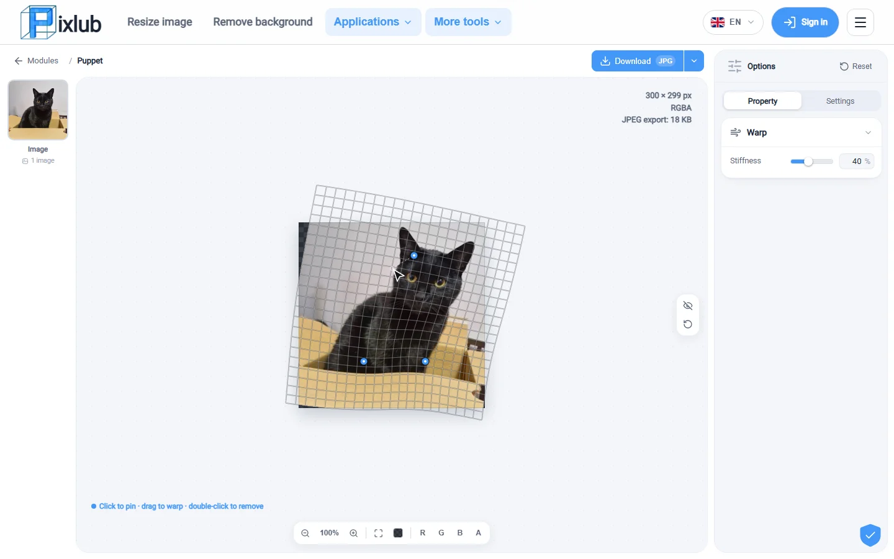

# Marioneta

Deformar una imagen colocando alfileres y moviéndolos.

**Categoría** : Transformación · **Identificador** : `puppet` · [Referencia de la API](./api.md)

## Dónde usarlo

- **[Página del módulo](https://pixlub.com/es/module/puppet)** : Suelte sus archivos, ajuste y descargue: el módulo por sí solo, sin nada más.
- **[Grafo de imagen](https://pixlub.com/es/image/graph)** : Conéctelo a otros módulos para componer un efecto más complejo.

## Entradas

Los archivos que acepta la página del módulo: suéltelos en la zona de importación o haga clic en ella para buscarlos. Un archivo de otro formato se descarta, con un mensaje que recuerda los formatos permitidos.

| Entrada | Formatos aceptados | Archivos |
| --- | --- | --- |
| **Imagen** (obligatoria) Imagen deformada por los alfileres. | `PNG`, `JPEG`, `WebP`, `GIF`, `AVIF`, `BMP` | Un archivo |

Mediante la API, los archivos y sus formatos se detallan en la [vista API](./api.md).

## Presentación en video

▶ [Ver el video](../../../../assets/modules/puppet/demo.en.mp4) : Colocar alfileres, deformar, ajustar la rigidez.

1. `0:00` Import a character
2. `0:02` Place pins
3. `0:07` Drag to warp
4. `0:11` Rigidity
5. `0:20` Double-click: remove a pin
6. `0:22` Export the result

## Uso

1. **Importar**

   Suelte una imagen, por ejemplo un personaje.

2. **Colocar alfileres**

   Haga clic en la vista previa para colocar alfileres en las partes que sujetar o mover.

3. **Deformar**

   Arrastre un alfiler: la imagen lo sigue y los demás alfileres se quedan en su sitio.

## Ajustes

| Ajuste | Efecto |
| --- | --- |
| **Rigidez** | 0 a 100 %. Alta: la imagen se dobla menos y conserva sus formas. Baja: sigue libremente. |
| **Alfileres** | Destino de cada alfiler (X, Y en % de la imagen), animable uno a uno en el grafo. |

Un **doble clic** en un alfiler lo quita.

## Consejos

- Coloque primero alfileres fijos (pies, cuerpo) antes de mover una cabeza o un brazo.
- El módulo procesa una sola imagen a la vez: los alfileres son propios de cada imagen.

## Exportación

El botón **Descargar** guarda el resultado en el formato del archivo importado: una foto JPEG sale en JPEG. El menú a su derecha abre los **Ajustes de exportación** para elegir otro formato y ajustar la calidad, el tamaño o el fondo, y ofrece **Copiar la imagen**.

- **[La ventana de exportación](../../../../01-app/es/02-image/04-exportation.md)** : Todos los formatos, sus ajustes, el procesamiento local o en el servidor, los lotes y la carpeta local.
