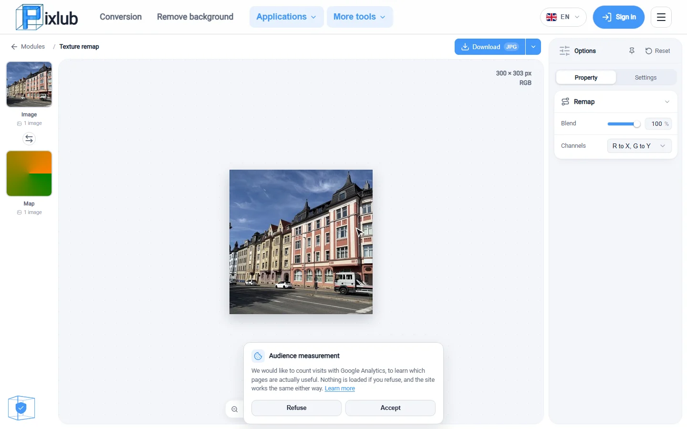

# Remapeo de textura

Redibujar una imagen leyendo, para cada píxel, la posición indicada por un mapa.

**Categoría** : Transformación · **Identificador** : `remap` · [Referencia de la API](./api.md)

## Dónde usarlo

- **[Página del módulo](https://pixlub.com/es/module/remap)** : Suelte sus archivos, ajuste y descargue: el módulo por sí solo, sin nada más.
- **[Grafo de imagen](https://pixlub.com/es/image/graph)** : Conéctelo a otros módulos para componer un efecto más complejo.

## Entradas

Los archivos que acepta la página del módulo: suéltelos en la zona de importación o haga clic en ella para buscarlos. Un archivo de otro formato se descarta, con un mensaje que recuerda los formatos permitidos.

| Entrada | Formatos aceptados | Archivos |
| --- | --- | --- |
| **Imagen** (obligatoria) Textura que se lee, repetida más allá de sus bordes. | `PNG`, `JPEG`, `WebP`, `GIF`, `AVIF`, `BMP` | Un archivo |
| **Mapa** (obligatoria) Imagen cuyo rojo indica la posición X que se lee y el verde, la posición Y. | `PNG`, `JPEG`, `WebP`, `GIF`, `AVIF`, `BMP` | Un archivo |

Mediante la API, los archivos y sus formatos se detallan en la [vista API](./api.md).

## Presentación en video

▶ [Ver el video](../../../../assets/modules/remap/demo.en.mp4) : Textura, mapa, mezcla y canales.

1. `0:00` Import an image
2. `0:02` Add a radial map
3. `0:05` Dose the blend
4. `0:15` Channels read from the map
5. `0:20` Export the result

## Uso

1. **Importar la textura**

   Suelte la imagen que volver a leer en la casilla **Imagen**; se repite más allá de sus bordes.

2. **Añadir el mapa**

   Suelte el mapa en la casilla **Mapa**: su rojo da la columna leída y su verde, la fila.

3. **Dosificar**

   Ajuste la **mezcla** y luego los **canales** que se leen en el mapa.

## Ajustes

| Ajuste | Efecto |
| --- | --- |
| **Mezcla** | 0 % deja la imagen intacta y 100 % lee por completo el mapa. |
| **Canales** | **R a X, G a Y**: 0 = borde izquierdo (o superior), 100 % = borde derecho (o inferior). **Luminancia**: la luminosidad da la posición en ambos ejes. |

## Consejos

- Un [Degradado](../../07-generate/gradient/README.md) radial negro → rojo (verde al 50 %) estira un ruido en rayos: animar su ángulo los hace girar.
- A diferencia del [Desplazamiento](../displace/README.md), que empuja cada píxel alrededor de su lugar, aquí el mapa da una posición absoluta.

## Exportación

El botón **Descargar** guarda el resultado en el formato del archivo importado: una foto JPEG sale en JPEG. El menú a su derecha abre los **Ajustes de exportación** para elegir otro formato y ajustar la calidad, el tamaño o el fondo, y ofrece **Copiar la imagen**.

- **[La ventana de exportación](../../../../01-app/es/02-image/04-exportation.md)** : Todos los formatos, sus ajustes, el procesamiento local o en el servidor, los lotes y la carpeta local.
