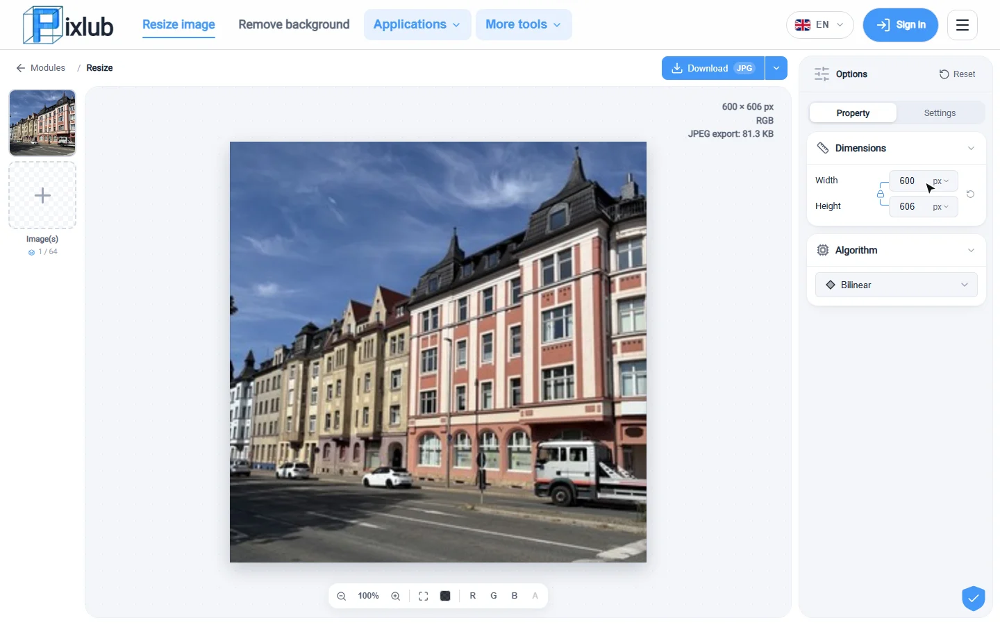
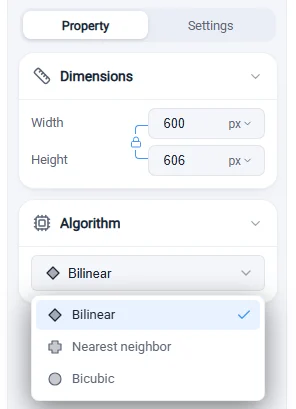

# Redimensionar

Cambiar el ancho y el alto de una imagen, en píxeles, en porcentaje, en centímetros o en pulgadas.

**Categoría** : Transformación · **Identificador** : `resize` · [Referencia de la API](./api.md)

## Dónde usarlo

- **[Página del módulo](https://pixlub.com/es/module/resize)** : Suelte sus archivos, ajuste y descargue: el módulo por sí solo, sin nada más.
- **[Grafo de imagen](https://pixlub.com/es/image/graph)** : Conéctelo a otros módulos para componer un efecto más complejo.

## Entradas

Los archivos que acepta la página del módulo: suéltelos en la zona de importación o haga clic en ella para buscarlos. Un archivo de otro formato se descarta, con un mensaje que recuerda los formatos permitidos.

| Entrada | Formatos aceptados | Archivos |
| --- | --- | --- |
| **Imagen(es)** (obligatoria) Imagen que se va a redimensionar. | `PNG`, `JPEG`, `WebP`, `GIF`, `AVIF`, `BMP` | Uno o varios: cada imagen se procesa por separado, con los mismos ajustes |

El número de imágenes que se procesan a la vez depende de su plan.

Mediante la API, los archivos y sus formatos se detallan en la [vista API](./api.md).

## Presentación en video

▶ [Ver el video](../../../../assets/modules/resize/demo.en.mp4) : Ancho, candado, unidades, algoritmos y lote de imágenes.

1. `0:00` Import an image
2. `0:02` Width: the height follows
3. `0:06` Padlock open: free width and height
4. `0:14` Units: percentage, centimeters, resolution
5. `0:29` Algorithms compared up close
6. `0:44` A batch of several images
7. `0:52` Export the result

## Uso

1. **Importar**

   Suelte una o varias imágenes. La esquina de la vista previa muestra su tamaño.

2. **Indicar una dimensión**

   Escriba el ancho **o** el alto: con el candado cerrado, el otro sigue las proporciones.

3. **Elegir el algoritmo**

   **Bilineal** sirve para la mayoría de las imágenes.

4. **Exportar**

   **Descargar**, o **Descargar en ZIP** para un lote.

## Ajustes

### Dimensiones

| Unidad | Valores |
| --- | --- |
| **px** | 0 a 8000 |
| **%** | 0 a 800 % del tamaño original |
| **cm** / **in** | 0 a 500 cm, 0 a 200 in, según la **resolución** (300 ppp por defecto) |

Los dos lados comparten la misma unidad. Un campo vacío («Auto») sigue las proporciones, o conserva el tamaño original si el candado está abierto.

| Candado | Efecto |
| --- | --- |
| **Cerrado** | Solo cuenta un lado; el otro lo sigue. En un lote, cada imagen conserva sus proporciones. |
| **Abierto** | Los dos lados son libres: la imagen puede deformarse. |

### Algoritmo

*Vecino más próximo, bilineal, bicúbico.*

| Algoritmo | Para |
| --- | --- |
| **Bilineal** | La mayoría de las imágenes. |
| **Vecino más próximo** | Pixel art, iconos: bordes nítidos. |
| **Bicúbico** | Reducir una foto conservando el detalle. |

## Consejos

- Un formato exacto sin deformación: pestaña **Ajustes**, tamaño **Libre** y **Cubrir**. Consulte [Tamaño del resultado](../../../../01-app/es/01-module-independant.md#tamano-del-resultado).
- Para ×2 o ×0,5, [Redimensionar (factor)](../resizeFactor/README.md) es más directo.
- Agrandar no añade detalle: parta de la imagen más grande disponible.

## Exportación

El botón **Descargar** guarda el resultado en el formato del archivo importado: una foto JPEG sale en JPEG. El menú a su derecha abre los **Ajustes de exportación** para elegir otro formato y ajustar la calidad, el tamaño o el fondo, y ofrece **Copiar la imagen**.

Con varias imágenes, el botón pasa a ser **Descargar en ZIP**; el menú también ofrece los archivos por separado o solo la imagen mostrada.

- **[La ventana de exportación](../../../../01-app/es/02-image/04-exportation.md)** : Todos los formatos, sus ajustes, el procesamiento local o en el servidor, los lotes y la carpeta local.
