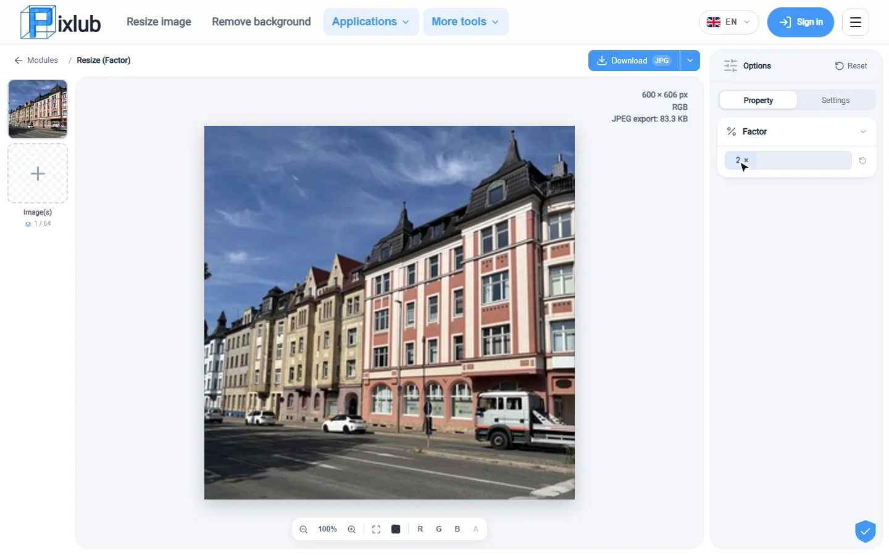

# Redimensionar (factor)

Agrandar o reducir una imagen por un factor: ×2, ×0,5…

**Categoría** : Transformación · **Identificador** : `resizeFactor` · [Referencia de la API](./api.md)

## Dónde usarlo

- **[Página del módulo](https://pixlub.com/es/module/resizeFactor)** : Suelte sus archivos, ajuste y descargue: el módulo por sí solo, sin nada más.
- **[Grafo de imagen](https://pixlub.com/es/image/graph)** : Conéctelo a otros módulos para componer un efecto más complejo.

## Entradas

Los archivos que acepta la página del módulo: suéltelos en la zona de importación o haga clic en ella para buscarlos. Un archivo de otro formato se descarta, con un mensaje que recuerda los formatos permitidos.

| Entrada | Formatos aceptados | Archivos |
| --- | --- | --- |
| **Imagen(es)** (obligatoria) Imagen escalada. | `PNG`, `JPEG`, `WebP`, `GIF`, `AVIF`, `BMP` | Uno o varios: cada imagen se procesa por separado, con los mismos ajustes |

El número de imágenes que se procesan a la vez depende de su plan.

Mediante la API, los archivos y sus formatos se detallan en la [vista API](./api.md).

## Presentación en video

▶ [Ver el video](../../../../assets/modules/resizeFactor/demo.en.mp4) : Duplicar, ajustar con el mouse y luego reducir a la mitad.

1. `0:00` Import an image
2. `0:02` Enlarge: factor 2
3. `0:06` Drag to adjust
4. `0:11` Halve it: 0.5
5. `0:15` Export the result

## Uso

1. **Importar**

   Suelte una o varias imágenes.

2. **Elegir el factor**

   Escriba el valor, o arrastre la barra. Las proporciones siempre se conservan.

3. **Exportar**

   **Descargar**, o **Descargar en ZIP** para un lote.

## Ajustes

| Ajuste | Efecto |
| --- | --- |
| **Factor** | De ×0,05 a ×8. **2** duplica el tamaño y **0,5** lo reduce a la mitad. |

## Consejos

- Para un tamaño preciso en píxeles o en centímetros, use [Redimensionar](../resize/README.md).
- Para pixel art, agrande con un factor entero (×2, ×3) para mantener píxeles regulares.

## Exportación

El botón **Descargar** guarda el resultado en el formato del archivo importado: una foto JPEG sale en JPEG. El menú a su derecha abre los **Ajustes de exportación** para elegir otro formato y ajustar la calidad, el tamaño o el fondo, y ofrece **Copiar la imagen**.

Con varias imágenes, el botón pasa a ser **Descargar en ZIP**; el menú también ofrece los archivos por separado o solo la imagen mostrada.

- **[La ventana de exportación](../../../../01-app/es/02-image/04-exportation.md)** : Todos los formatos, sus ajustes, el procesamiento local o en el servidor, los lotes y la carpeta local.
