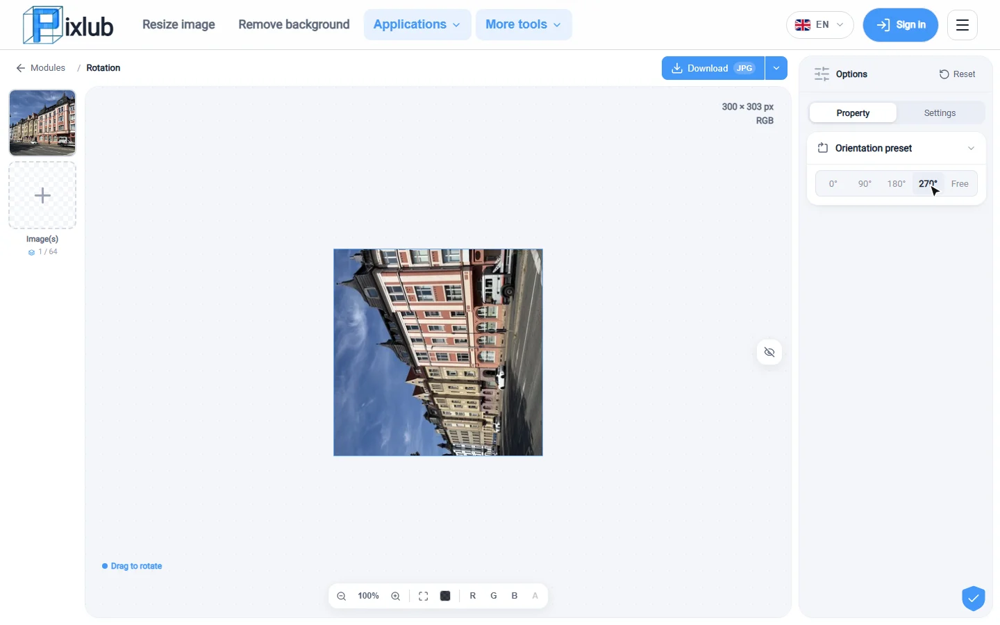

# Rotación

Girar una imagen un cuarto de vuelta o un ángulo libre.

**Categoría** : Transformación · **Identificador** : `rotate` · [Referencia de la API](./api.md)

## Dónde usarlo

- **[Página del módulo](https://pixlub.com/es/module/rotate)** : Suelte sus archivos, ajuste y descargue: el módulo por sí solo, sin nada más.
- **[Grafo de imagen](https://pixlub.com/es/image/graph)** : Conéctelo a otros módulos para componer un efecto más complejo.

## Entradas

Los archivos que acepta la página del módulo: suéltelos en la zona de importación o haga clic en ella para buscarlos. Un archivo de otro formato se descarta, con un mensaje que recuerda los formatos permitidos.

| Entrada | Formatos aceptados | Archivos |
| --- | --- | --- |
| **Imagen(es)** (obligatoria) Imagen que se va a girar. | `PNG`, `JPEG`, `WebP`, `GIF`, `AVIF`, `BMP` | Uno o varios: cada imagen se procesa por separado, con los mismos ajustes |

El número de imágenes que se procesan a la vez depende de su plan.

Mediante la API, los archivos y sus formatos se detallan en la [vista API](./api.md).

## Presentación en video

▶ [Ver el video](../../../../assets/modules/rotate/demo.en.mp4) : Orientaciones predefinidas, ángulo libre, rotación con el mouse.

1. `0:00` Import an image
2. `0:02` Ready-made orientations
3. `0:06` Free angle
4. `0:11` Rotate with the mouse
5. `0:15` Export the result

## Uso

1. **Importar**

   Suelte una o varias imágenes.

2. **Elegir la orientación**

   **90°**, **180°** o **270°** con un clic.

3. **O un ángulo libre**

   Elija **Libre** y luego escriba el ángulo o gire la imagen arrastrándola en la vista previa.

## Ajustes

| Ajuste | Efecto |
| --- | --- |
| **Orientación** | 0°, 90°, 180°, 270° o **Libre**. |
| **Ángulo** | En modo Libre: −180° a 180°. |

Con un ángulo libre, la imagen se agranda para conservar las esquinas; las esquinas añadidas son **transparentes**.

## Consejos

- Para enderezar una foto torcida, suele bastar un ángulo de 1° a 5°; recorte después con [Recortar](../crop/README.md).
- Para voltear la imagen en espejo en lugar de girarla, use [Espejo](../flip/README.md).

## Exportación

El botón **Descargar** guarda el resultado en el formato del archivo importado: una foto JPEG sale en JPEG. El menú a su derecha abre los **Ajustes de exportación** para elegir otro formato y ajustar la calidad, el tamaño o el fondo, y ofrece **Copiar la imagen**.

Con varias imágenes, el botón pasa a ser **Descargar en ZIP**; el menú también ofrece los archivos por separado o solo la imagen mostrada.

- **[La ventana de exportación](../../../../01-app/es/02-image/04-exportation.md)** : Todos los formatos, sus ajustes, el procesamiento local o en el servidor, los lotes y la carpeta local.
