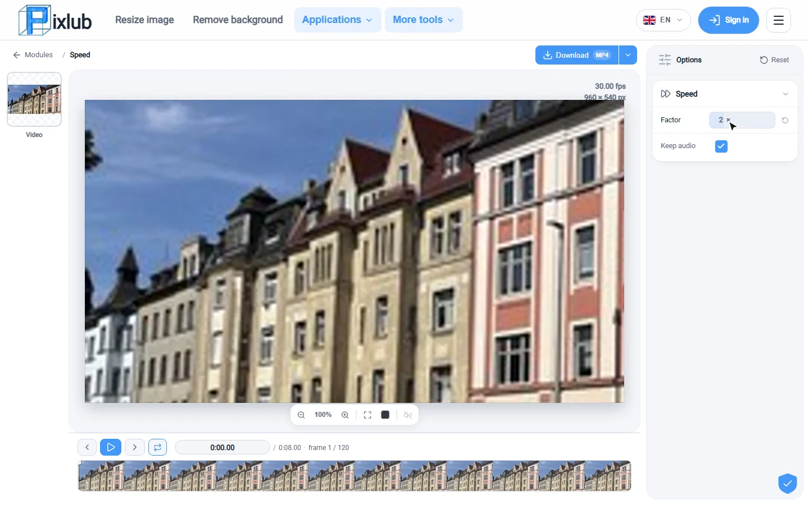

# Velocidad

Acelerar o ralentizar un video.

**Categoría** : Transformación · **Identificador** : `speedVideo`

## Dónde usarlo

- **[Página del módulo](https://pixlub.com/es/module/speedVideo)** : Suelte sus archivos, ajuste y descargue: el módulo por sí solo, sin nada más.
- **[Editor de video](https://pixlub.com/es/video/editor)** : Añádalo como efecto en un clip del montaje.

## Entradas

Los archivos que acepta la página del módulo: suéltelos en la zona de importación o haga clic en ella para buscarlos. Un archivo de otro formato se descarta, con un mensaje que recuerda los formatos permitidos.

| Entrada | Formatos aceptados | Archivos |
| --- | --- | --- |
| **Video** (obligatoria) Video acelerado o ralentizado. | `MP4`, `WebM`, `MOV`, `MKV` | Un archivo |

## Presentación en video

▶ [Ver el video](../../../../assets/modules/speedVideo/demo.en.mp4) : Acelerar ×2 y luego ralentizar ×0,5.

1. `0:00` Import a video
2. `0:03` Speed up: factor 2
3. `0:11` Slow down: factor 0.5
4. `0:19` Export the result

## Uso

1. **Importar**

   Suelte un video.

2. **Elegir el factor**

   Por encima de 1, el video se acelera; por debajo, se ralentiza. Reproduzca la vista previa para juzgar.

## Ajustes

| Ajuste | Efecto |
| --- | --- |
| **Factor** | ×0,25 a ×8. **2** reduce la duración a la mitad. |
| **Conservar el sonido** | Marcado: el sonido sigue la velocidad. Desmarcado: el video sale sin sonido, más rápido. |

La velocidad de fotogramas no cambia: lo que cambia son los fotogramas tomados del origen.

## Consejos

- Para una cámara lenta fluida, parta de un video grabado a alta velocidad de fotogramas (50 o 60 fps).
- Para reducir el peso sin cambiar la duración, baje mejor la [Velocidad de fotogramas](../frameRateVideo/README.md).

## Exportación

El resultado se exporta desde la página del módulo o desde el editor de video, en MP4, WebM u otro contenedor de video, sin salir de su navegador.

- **[El editor de video](../../../../01-app/es/03-video/01-video-editor.md)** : Editar, ajustar los efectos y exportar un video.
