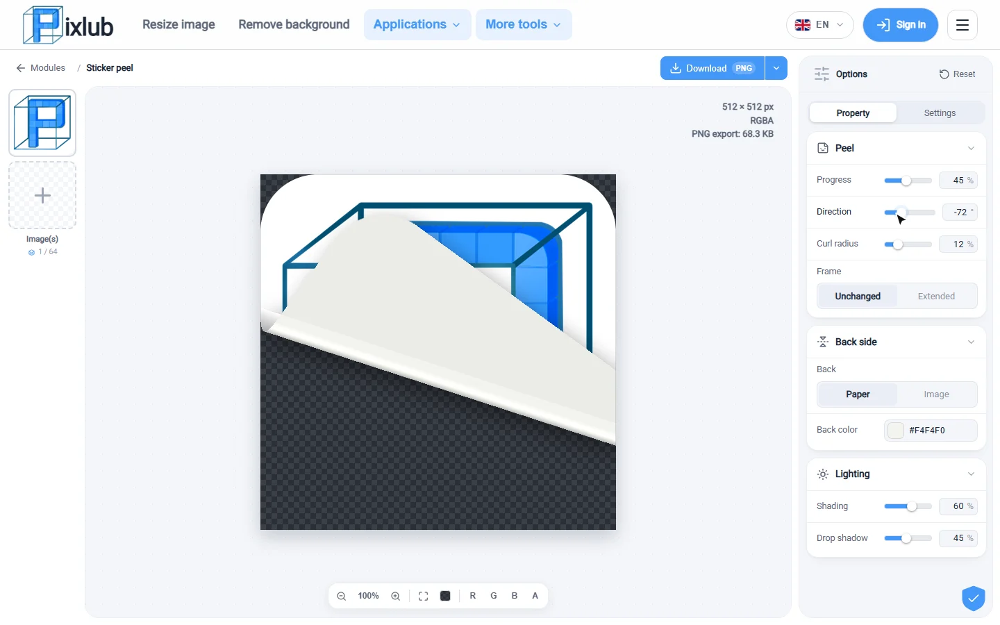

# Sticker

Despegar una imagen como una pegatina, enrollándola en la dirección elegida.

**Categoría** : Transformación · **Identificador** : `sticker` · [Referencia de la API](./api.md)

## Dónde usarlo

- **[Página del módulo](https://pixlub.com/es/module/sticker)** : Suelte sus archivos, ajuste y descargue: el módulo por sí solo, sin nada más.
- **[Grafo de imagen](https://pixlub.com/es/image/graph)** : Conéctelo a otros módulos para componer un efecto más complejo.

## Entradas

Los archivos que acepta la página del módulo: suéltelos en la zona de importación o haga clic en ella para buscarlos. Un archivo de otro formato se descarta, con un mensaje que recuerda los formatos permitidos.

| Entrada | Formatos aceptados | Archivos |
| --- | --- | --- |
| **Imagen(es)** (obligatoria) Imagen despegada como un sticker; su transparencia da la forma del sticker. | `PNG`, `JPEG`, `WebP`, `GIF`, `AVIF`, `BMP` | Uno o varios: cada imagen se procesa por separado, con los mismos ajustes |

El número de imágenes que se procesan a la vez depende de su plan.

Mediante la API, los archivos y sus formatos se detallan en la [vista API](./api.md).

## Presentación en video

▶ [Ver el video](../../../../assets/modules/sticker/demo.en.mp4) : Avance, dirección, rollo, dorso y luz.

1. `0:00` Import a transparent image
2. `0:02` Progress and direction
3. `0:09` Roll radius
4. `0:13` Back of the sticker
5. `0:18` Shading and shadow
6. `0:25` Export the result

## Uso

1. **Importar**

   Suelte una imagen. Su transparencia da la forma de la pegatina: un logotipo recortado funciona muy bien.

2. **Despegar**

   Ajuste el **avance** del pliegue y su **dirección**.

3. **Terminar**

   Elija el **dorso** (papel o imagen) y dosifique la **iluminación**.

## Ajustes

| Ajuste | Efecto |
| --- | --- |
| **Avance** | 0 %: pegada; 100 %: completamente dada la vuelta. |
| **Dirección** | Sentido en el que avanza el pliegue (−180° a 180°). |
| **Radio del rollo** | Redondez de la parte que se enrolla. |
| **Marco** | **Ampliado** ensancha la imagen para mostrar entera la pegatina dada la vuelta. |
| **Dorso** | **Papel** (color sólido) o **Imagen** (vista por transparencia, en espejo). |
| **Modelado** / **Sombra proyectada** | Relieve del rollo y sombra sobre el fondo. |

## Consejos

- Exporte en PNG o WebP para conservar la transparencia alrededor de la pegatina.
- Para el efecto de una esquina que se despega, mantenga un **avance** bajo (del 10 al 25 %).

## Exportación

El botón **Descargar** guarda el resultado en el formato del archivo importado: una foto JPEG sale en JPEG. El menú a su derecha abre los **Ajustes de exportación** para elegir otro formato y ajustar la calidad, el tamaño o el fondo, y ofrece **Copiar la imagen**.

Con varias imágenes, el botón pasa a ser **Descargar en ZIP**; el menú también ofrece los archivos por separado o solo la imagen mostrada.

- **[La ventana de exportación](../../../../01-app/es/02-image/04-exportation.md)** : Todos los formatos, sus ajustes, el procesamiento local o en el servidor, los lotes y la carpeta local.
