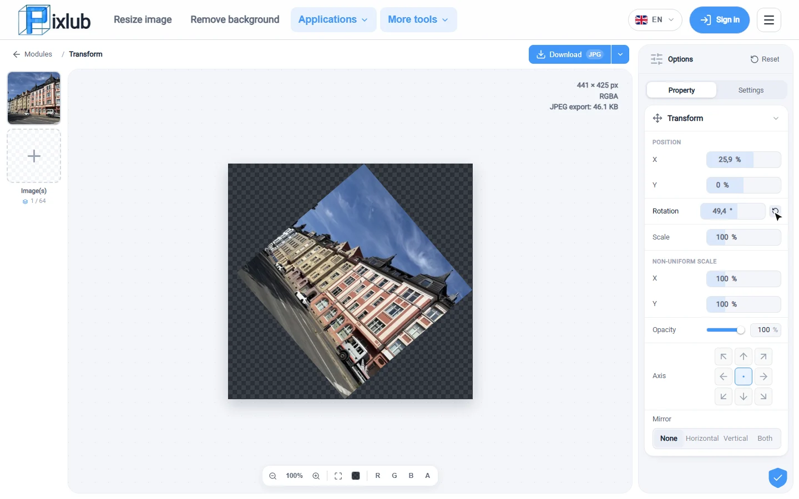

# Transformación

Mover, girar, escalar, voltear y atenuar una imagen de una sola vez.

**Categoría** : Transformación · **Identificador** : `transform` · [Referencia de la API](./api.md)

## Dónde usarlo

- **[Página del módulo](https://pixlub.com/es/module/transform)** : Suelte sus archivos, ajuste y descargue: el módulo por sí solo, sin nada más.
- **[Grafo de imagen](https://pixlub.com/es/image/graph)** : Conéctelo a otros módulos para componer un efecto más complejo.

## Entradas

Los archivos que acepta la página del módulo: suéltelos en la zona de importación o haga clic en ella para buscarlos. Un archivo de otro formato se descarta, con un mensaje que recuerda los formatos permitidos.

| Entrada | Formatos aceptados | Archivos |
| --- | --- | --- |
| **Imagen(es)** (obligatoria) Imagen transformada. | `PNG`, `JPEG`, `WebP`, `GIF`, `AVIF`, `BMP` | Uno o varios: cada imagen se procesa por separado, con los mismos ajustes |

El número de imágenes que se procesan a la vez depende de su plan.

Mediante la API, los archivos y sus formatos se detallan en la [vista API](./api.md).

## Presentación en video

▶ [Ver el video](../../../../assets/modules/transform/demo.en.mp4) : Posición, rotación, escala, opacidad, espejo y eje.

1. `0:00` Import an image
2. `0:02` Position and rotation
3. `0:09` Scale
4. `0:14` Opacity and mirror
5. `0:20` Transform axis
6. `0:26` Export the result

## Uso

1. **Importar**

   Suelte una o varias imágenes.

2. **Ajustar**

   En la vista previa, arrastre la imagen para moverla, tire de una esquina para la escala y del punto superior para girar; o ajuste cada apartado (Posición, Escala, Rotación…).

3. **Elegir el eje**

   El **eje** es el punto alrededor del cual la imagen gira, crece y se voltea.

## Ajustes

| Ajuste | Efecto |
| --- | --- |
| **X** / **Y** | Desplazamiento, en % del ancho y del alto. |
| **Rotación** | −360° a 360°, alrededor del eje. |
| **Escala** | 0 a 400 %, en ambos ejes. |
| **Escala no uniforme X** / **Y** | Estira a lo ancho o a lo alto, además de la escala. |
| **Opacidad** | 0 a 100 %. |
| **Eje** | Centro, esquina o borde de referencia. |
| **Espejo** | Ninguno, horizontal, vertical o ambos. |

La imagen conserva su tamaño: lo que sale se corta y el espacio liberado es **transparente**.

## Consejos

- En el [grafo de imagen](../../../../01-app/es/02-image/01-image-graph.md), coloque Transformación antes de una fusión para poner una capa donde quiera.
- Para girar solo la imagen entera sin cortarla, prefiera [Rotación](../rotate/README.md).

## Exportación

El botón **Descargar** guarda el resultado en el formato del archivo importado: una foto JPEG sale en JPEG. El menú a su derecha abre los **Ajustes de exportación** para elegir otro formato y ajustar la calidad, el tamaño o el fondo, y ofrece **Copiar la imagen**.

Con varias imágenes, el botón pasa a ser **Descargar en ZIP**; el menú también ofrece los archivos por separado o solo la imagen mostrada.

- **[La ventana de exportación](../../../../01-app/es/02-image/04-exportation.md)** : Todos los formatos, sus ajustes, el procesamiento local o en el servidor, los lotes y la carpeta local.
