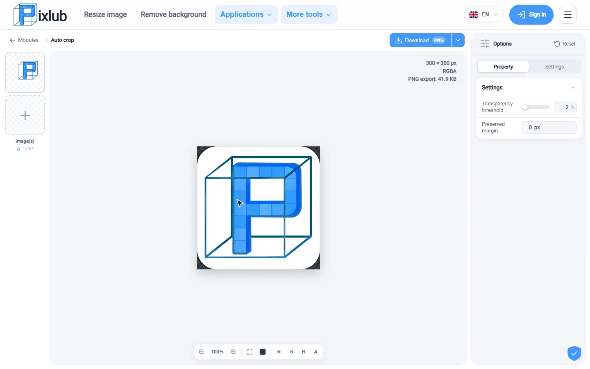

# Recorte automático

Recortar automáticamente los bordes transparentes de una imagen.

**Categoría** : Transformación · **Identificador** : `trim` · [Referencia de la API](./api.md)

## Dónde usarlo

- **[Página del módulo](https://pixlub.com/es/module/trim)** : Suelte sus archivos, ajuste y descargue: el módulo por sí solo, sin nada más.
- **[Grafo de imagen](https://pixlub.com/es/image/graph)** : Conéctelo a otros módulos para componer un efecto más complejo.

## Entradas

Los archivos que acepta la página del módulo: suéltelos en la zona de importación o haga clic en ella para buscarlos. Un archivo de otro formato se descarta, con un mensaje que recuerda los formatos permitidos.

| Entrada | Formatos aceptados | Archivos |
| --- | --- | --- |
| **Imagen(es)** (obligatoria) Imagen cuyos bordes transparentes se recortan. | `PNG`, `JPEG`, `WebP`, `GIF`, `AVIF`, `BMP` | Uno o varios: cada imagen se procesa por separado, con los mismos ajustes |

El número de imágenes que se procesan a la vez depende de su plan.

Mediante la API, los archivos y sus formatos se detallan en la [vista API](./api.md).

## Presentación en video

▶ [Ver el video](../../../../assets/modules/trim/demo.en.mp4) : Bordes vacíos eliminados, margen conservado, umbral de transparencia.

1. `0:00` Import a transparent image
2. `0:03` Empty edges are trimmed
3. `0:07` Keep a margin
4. `0:11` Transparency threshold
5. `0:16` Export the result

## Uso

1. **Importar**

   Suelte una imagen con transparencia (PNG, WebP…).

2. **Eso es todo**

   Los bordes vacíos desaparecen: la imagen se ciñe a su contenido.

3. **Ajustar si es necesario**

   Conserve un **margen** alrededor del contenido, o suba el **umbral** para ignorar los píxeles casi transparentes.

## Ajustes

| Ajuste | Efecto |
| --- | --- |
| **Umbral de transparencia** | 0 a 100 %. Un píxel menos opaco que este umbral cuenta como vacío. |
| **Margen conservado** | 0 a 500 px conservados alrededor del contenido. |

## Consejos

- Ideal tras quitar un fondo: el objeto queda encuadrado lo más cerca posible.
- Una imagen sin transparencia no cambia: use [Recortar](../crop/README.md).

## Exportación

El botón **Descargar** guarda el resultado en el formato del archivo importado: una foto JPEG sale en JPEG. El menú a su derecha abre los **Ajustes de exportación** para elegir otro formato y ajustar la calidad, el tamaño o el fondo, y ofrece **Copiar la imagen**.

Con varias imágenes, el botón pasa a ser **Descargar en ZIP**; el menú también ofrece los archivos por separado o solo la imagen mostrada.

- **[La ventana de exportación](../../../../01-app/es/02-image/04-exportation.md)** : Todos los formatos, sus ajustes, el procesamiento local o en el servidor, los lotes y la carpeta local.
