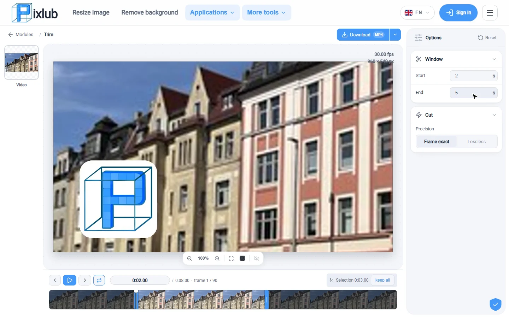

# Recorte

Conservar un fragmento de un video, entre un inicio y un final.

**Categoría** : Transformación · **Identificador** : `trimVideo`

## Dónde usarlo

- **[Página del módulo](https://pixlub.com/es/module/trimVideo)** : Suelte sus archivos, ajuste y descargue: el módulo por sí solo, sin nada más.
- **[Editor de video](https://pixlub.com/es/video/editor)** : Añádalo como efecto en un clip del montaje.

## Entradas

Los archivos que acepta la página del módulo: suéltelos en la zona de importación o haga clic en ella para buscarlos. Un archivo de otro formato se descarta, con un mensaje que recuerda los formatos permitidos.

| Entrada | Formatos aceptados | Archivos |
| --- | --- | --- |
| **Video** (obligatoria) Video del que se conserva una parte. | `MP4`, `WebM`, `MOV`, `MKV` | Un archivo |

## Presentación en video

▶ [Ver el video](../../../../assets/modules/trimVideo/demo.en.mp4) : Inicio y final, reproducción del fragmento, precisión del corte.

1. `0:00` Import a video
2. `0:05` Start and end of the clip
3. `0:10` Play the kept part
4. `0:16` Cut precision
5. `0:19` Export the result

## Uso

1. **Importar**

   Suelte un video.

2. **Indicar el inicio y el final**

   En segundos. Reproduzca la vista previa para comprobar el fragmento conservado.

3. **Elegir la precisión**

   **Al fotograma** corta con exactitud; **Sin pérdida** va más rápido.

## Ajustes

| Ajuste | Efecto |
| --- | --- |
| **Inicio** | Tiempo de inicio, en segundos. |
| **Final** | Tiempo final, en segundos. **0** conserva hasta el final. |
| **Precisión** | **Al fotograma**: vuelve a codificar el video. **Sin pérdida**: lo copia tal cual, con el inicio ajustado al fotograma clave más cercano. |

Todo se hace en el navegador: el video no se envía.

## Consejos

- **Sin pérdida** conserva la calidad original y exporta en unos segundos, pero el inicio puede adelantarse una fracción de segundo.
- Para cambiar el ritmo del fragmento conservado: [Velocidad](../speedVideo/README.md).

## Exportación

El resultado se exporta desde la página del módulo o desde el editor de video, en MP4, WebM u otro contenedor de video, sin salir de su navegador.

- **[El editor de video](../../../../01-app/es/03-video/01-video-editor.md)** : Editar, ajustar los efectos y exportar un video.
