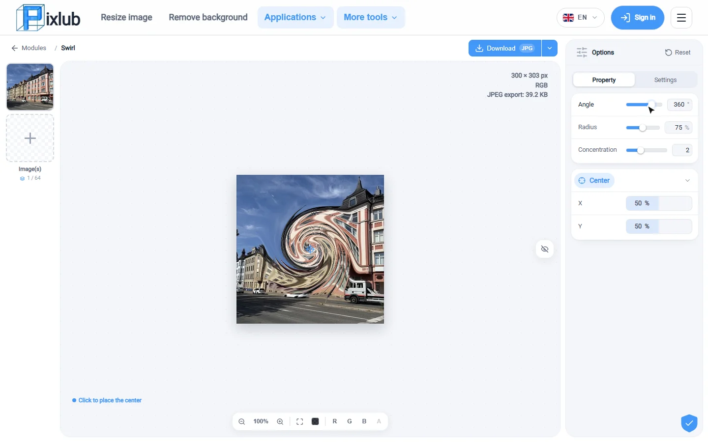

# Remolino

Torcer una imagen en espiral alrededor de un centro.

**Categoría** : Transformación · **Identificador** : `twirl` · [Referencia de la API](./api.md)

## Dónde usarlo

- **[Página del módulo](https://pixlub.com/es/module/twirl)** : Suelte sus archivos, ajuste y descargue: el módulo por sí solo, sin nada más.
- **[Grafo de imagen](https://pixlub.com/es/image/graph)** : Conéctelo a otros módulos para componer un efecto más complejo.

## Entradas

Los archivos que acepta la página del módulo: suéltelos en la zona de importación o haga clic en ella para buscarlos. Un archivo de otro formato se descarta, con un mensaje que recuerda los formatos permitidos.

| Entrada | Formatos aceptados | Archivos |
| --- | --- | --- |
| **Imagen(es)** (obligatoria) Imagen retorcida en espiral. | `PNG`, `JPEG`, `WebP`, `GIF`, `AVIF`, `BMP` | Uno o varios: cada imagen se procesa por separado, con los mismos ajustes |

El número de imágenes que se procesan a la vez depende de su plan.

Mediante la API, los archivos y sus formatos se detallan en la [vista API](./api.md).

## Presentación en video

▶ [Ver el video](../../../../assets/modules/twirl/demo.en.mp4) : Ángulo, radio, concentración y centro.

1. `0:00` Import an image
2. `0:03` Twirl angle
3. `0:06` Radius and concentration
4. `0:13` Place the center
5. `0:15` Export the result

## Uso

1. **Importar**

   Suelte una o varias imágenes.

2. **Torcer**

   El **ángulo** fija el número de vueltas y el **radio**, el tamaño del remolino.

3. **Colocar el centro**

   Haga clic en la vista previa.

## Ajustes

| Ajuste | Efecto |
| --- | --- |
| **Ángulo** | −720° a 720°. El signo elige el sentido. |
| **Radio** | 1 a 150 %: zona afectada alrededor del centro. |
| **Concentración** | 1 a 4. Alta: la torsión se concentra en el centro. |
| **Centro X** / **Y** | Posición del centro, en %. |

## Consejos

- Un ángulo pequeño (30° a 90°) basta para un efecto de agua que gira.
- Para un efecto de lupa en lugar de espiral: [Distorsión de lente](../fisheye/README.md).

## Exportación

El botón **Descargar** guarda el resultado en el formato del archivo importado: una foto JPEG sale en JPEG. El menú a su derecha abre los **Ajustes de exportación** para elegir otro formato y ajustar la calidad, el tamaño o el fondo, y ofrece **Copiar la imagen**.

Con varias imágenes, el botón pasa a ser **Descargar en ZIP**; el menú también ofrece los archivos por separado o solo la imagen mostrada.

- **[La ventana de exportación](../../../../01-app/es/02-image/04-exportation.md)** : Todos los formatos, sus ajustes, el procesamiento local o en el servidor, los lotes y la carpeta local.
