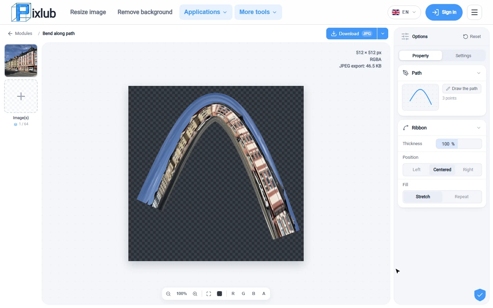

# Curvar sobre un camino

Curvar una imagen a lo largo de un trazado, como una cinta.

**Categoría** : Transformación · **Identificador** : `warpPath` · [Referencia de la API](./api.md)

## Dónde usarlo

- **[Página del módulo](https://pixlub.com/es/module/warpPath)** : Suelte sus archivos, ajuste y descargue: el módulo por sí solo, sin nada más.
- **[Grafo de imagen](https://pixlub.com/es/image/graph)** : Conéctelo a otros módulos para componer un efecto más complejo.

## Entradas

Los archivos que acepta la página del módulo: suéltelos en la zona de importación o haga clic en ella para buscarlos. Un archivo de otro formato se descarta, con un mensaje que recuerda los formatos permitidos.

| Entrada | Formatos aceptados | Archivos |
| --- | --- | --- |
| **Imagen** (obligatoria) Imagen curvada a lo largo del camino: su ancho sigue el trazado y su alto se convierte en el grosor de la cinta. | `PNG`, `JPEG`, `WebP`, `GIF`, `AVIF`, `BMP` | Un archivo |

Mediante la API, los archivos y sus formatos se detallan en la [vista API](./api.md).

## Presentación en video

▶ [Ver el video](../../../../assets/modules/warpPath/demo.en.mp4) : Redibujar el trazado, ajustar el grosor, la posición y el relleno.

1. `0:00` Import an image
2. `0:03` Redraw the path
3. `0:19` Ribbon thickness
4. `0:23` Position and fill
5. `0:28` Export the result

## Uso

1. **Importar**

   Suelte una imagen: su ancho sigue el trazado y su alto se convierte en el grosor de la cinta.

2. **Dibujar el trazado**

   **Dibujar el trazado** abre el editor: haga clic para añadir un punto, arrástrelo para moverlo, haga doble clic para quitarlo y luego **Validar**.

3. **Ajustar la cinta**

   Grosor, posición y relleno en el panel.

## Ajustes

| Ajuste | Efecto |
| --- | --- |
| **Trazado** | Los puntos del camino, con suavizado y redondeo de las esquinas. |
| **Grosor** | 10 a 200 %. Al 100 %, la imagen conserva sus proporciones. |
| **Posición** | Cinta **a la izquierda**, **centrada** o **a la derecha** del trazado. |
| **Relleno** | **Estirar** una vez a lo largo de todo el trazado, o **Repetir** la imagen. |

El resultado tiene el tamaño del marco del trazado; el resto es **transparente**.

## Consejos

- Un grosor excesivo se estrecha en las curvas cerradas: suavice la curva o baje el grosor.
- **Repetir** conviene a los motivos (friso, cinta decorativa) y **Estirar**, a un texto o una foto.

## Exportación

El botón **Descargar** guarda el resultado en el formato del archivo importado: una foto JPEG sale en JPEG. El menú a su derecha abre los **Ajustes de exportación** para elegir otro formato y ajustar la calidad, el tamaño o el fondo, y ofrece **Copiar la imagen**.

- **[La ventana de exportación](../../../../01-app/es/02-image/04-exportation.md)** : Todos los formatos, sus ajustes, el procesamiento local o en el servidor, los lotes y la carpeta local.
