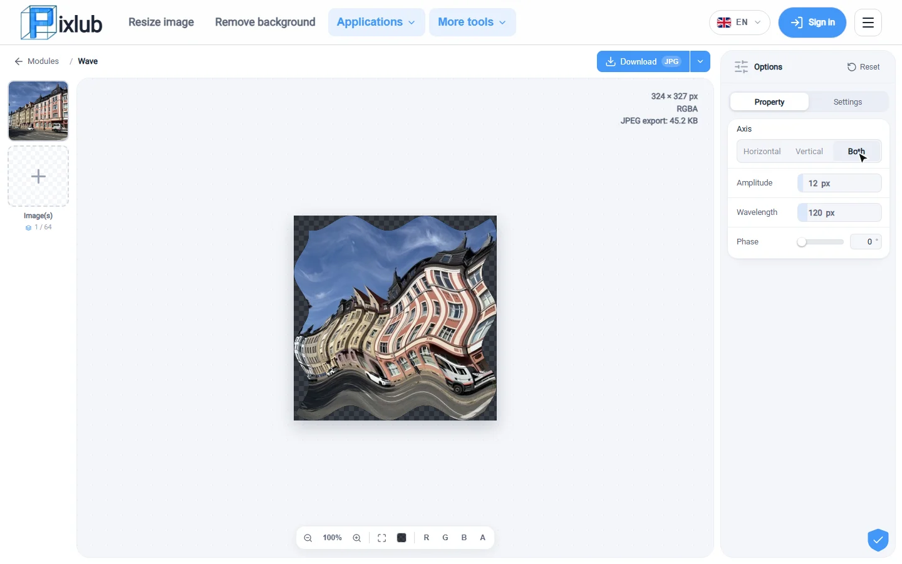

# Onda

Ondular una imagen en ondas horizontales, verticales o en ambos sentidos.

**Categoría** : Transformación · **Identificador** : `wave` · [Referencia de la API](./api.md)

## Dónde usarlo

- **[Página del módulo](https://pixlub.com/es/module/wave)** : Suelte sus archivos, ajuste y descargue: el módulo por sí solo, sin nada más.
- **[Grafo de imagen](https://pixlub.com/es/image/graph)** : Conéctelo a otros módulos para componer un efecto más complejo.

## Entradas

Los archivos que acepta la página del módulo: suéltelos en la zona de importación o haga clic en ella para buscarlos. Un archivo de otro formato se descarta, con un mensaje que recuerda los formatos permitidos.

| Entrada | Formatos aceptados | Archivos |
| --- | --- | --- |
| **Imagen(es)** (obligatoria) Imagen deformada por la onda. | `PNG`, `JPEG`, `WebP`, `GIF`, `AVIF`, `BMP` | Uno o varios: cada imagen se procesa por separado, con los mismos ajustes |

El número de imágenes que se procesan a la vez depende de su plan.

Mediante la API, los archivos y sus formatos se detallan en la [vista API](./api.md).

## Presentación en video

▶ [Ver el video](../../../../assets/modules/wave/demo.en.mp4) : Eje, amplitud, longitud de onda y fase.

1. `0:00` Import an image
2. `0:03` Wave axis
3. `0:07` Amplitude and wavelength
4. `0:11` Phase
5. `0:16` Export the result

## Uso

1. **Importar**

   Suelte una o varias imágenes.

2. **Elegir el eje**

   **Horizontal**, **Vertical** o **Ambos** para un efecto de bandera.

3. **Ajustar las ondas**

   **Amplitud** para su altura y **longitud de onda** para su separación.

## Ajustes

| Ajuste | Efecto |
| --- | --- |
| **Eje** | Horizontal, vertical o ambos. |
| **Amplitud** | 0 a 200 px. |
| **Longitud de onda** | 4 a 1000 px entre dos crestas. |
| **Fase** | 0° a 360°. Desliza las ondas. |

## Consejos

- Una longitud de onda grande y una amplitud pequeña dan un ligero temblor, como un reflejo.
- Anime la **fase** en el [grafo de imagen](../../../../01-app/es/02-image/01-image-graph.md) para una bandera que ondea.

## Exportación

El botón **Descargar** guarda el resultado en el formato del archivo importado: una foto JPEG sale en JPEG. El menú a su derecha abre los **Ajustes de exportación** para elegir otro formato y ajustar la calidad, el tamaño o el fondo, y ofrece **Copiar la imagen**.

Con varias imágenes, el botón pasa a ser **Descargar en ZIP**; el menú también ofrece los archivos por separado o solo la imagen mostrada.

- **[La ventana de exportación](../../../../01-app/es/02-image/04-exportation.md)** : Todos los formatos, sus ajustes, el procesamiento local o en el servidor, los lotes y la carpeta local.
