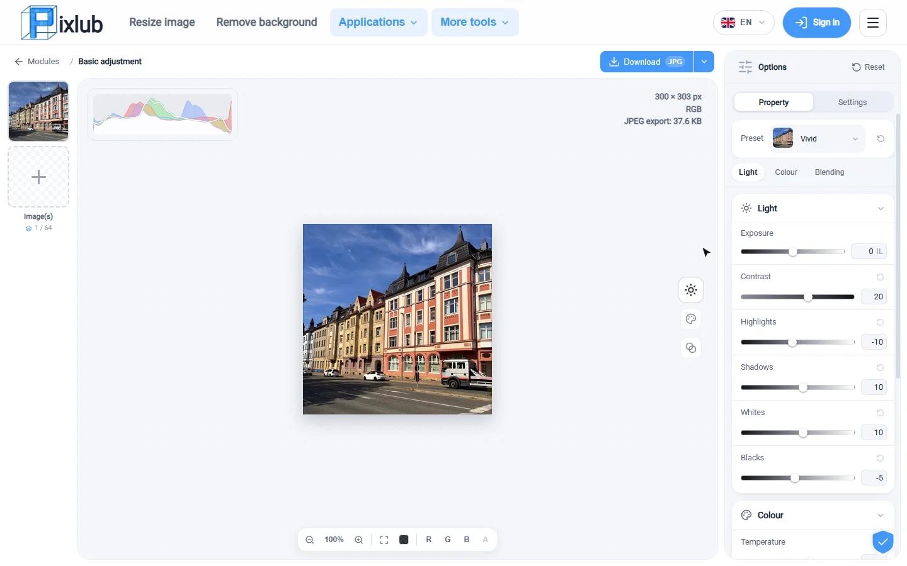

# Ajuste básico

Los ajustes esenciales de una foto reunidos: luz, tonos, balance de blancos y colores.

**Categoría** : Ajuste · **Identificador** : `baseAdjust` · [Referencia de la API](./api.md)

## Dónde usarlo

- **[Página del módulo](https://pixlub.com/es/module/baseAdjust)** : Suelte sus archivos, ajuste y descargue: el módulo por sí solo, sin nada más.
- **[Grafo de imagen](https://pixlub.com/es/image/graph)** : Conéctelo a otros módulos para componer un efecto más complejo.

## Entradas

Los archivos que acepta la página del módulo: suéltelos en la zona de importación o haga clic en ella para buscarlos. Un archivo de otro formato se descarta, con un mensaje que recuerda los formatos permitidos.

| Entrada | Formatos aceptados | Archivos |
| --- | --- | --- |
| **Imagen(es)** (obligatoria) Imagen que se va a revelar. | `PNG`, `JPEG`, `WebP`, `GIF`, `AVIF`, `BMP` | Uno o varios: cada imagen se procesa por separado, con los mismos ajustes |

El número de imágenes que se procesan a la vez depende de su plan.

Mediante la API, los archivos y sus formatos se detallan en la [vista API](./api.md).

## Presentación en video

▶ [Ver el video](../../../../assets/modules/baseAdjust/demo.en.mp4) : Preajuste, luz, color.

1. `0:00` Import an image
2. `0:02` Start from a preset
3. `0:10` Light
4. `0:20` Colour
5. `0:28` Export the result

## Uso

1. **Importar**

   Suelte una o varias imágenes.

2. **Partir de un preajuste**

   Elija un **preajuste** en la parte superior del panel, o quédese en **Personalizado**.

3. **Afinar**

   Las pestañas **Luz**, **Color** y **Fusión** llevan a cada grupo de controles deslizantes.

## Ajustes

| Ajuste | Efecto |
| --- | --- |
| **Exposición** | −5 a 5 pasos. +1 duplica la luz y −1 la reduce a la mitad. |
| **Contraste** | Separa o acerca los tonos claros y oscuros. |
| **Altas luces** / **Sombras** | Oscurece los tonos claros (un cielo) y aclara los tonos oscuros. |
| **Blancos** / **Negros** | Desplaza los puntos blanco y negro. |
| **Temperatura** / **Matiz** | Azul ↔ amarillo anaranjado, verde ↔ magenta. |
| **Intensidad** / **Saturación** | Aviva sobre todo los colores apagados / todos los colores (−100: gris). |
| **Desplazamiento de tono** | −180° a 180° en el círculo cromático. |
| **Fusión** | Modo de fusión y opacidad: cómo se aplica el ajuste sobre la imagen original. |

## Consejos

- Para una foto apagada, prefiera la **intensidad** a la saturación: los colores ya vivos no se saturan.
- Para apilar varios ajustes, use el [editor de ajustes](../../../../01-app/es/02-image/03-image-adjust.md).

## Exportación

El botón **Descargar** guarda el resultado en el formato del archivo importado: una foto JPEG sale en JPEG. El menú a su derecha abre los **Ajustes de exportación** para elegir otro formato y ajustar la calidad, el tamaño o el fondo, y ofrece **Copiar la imagen**.

Con varias imágenes, el botón pasa a ser **Descargar en ZIP**; el menú también ofrece los archivos por separado o solo la imagen mostrada.

- **[La ventana de exportación](../../../../01-app/es/02-image/04-exportation.md)** : Todos los formatos, sus ajustes, el procesamiento local o en el servidor, los lotes y la carpeta local.
