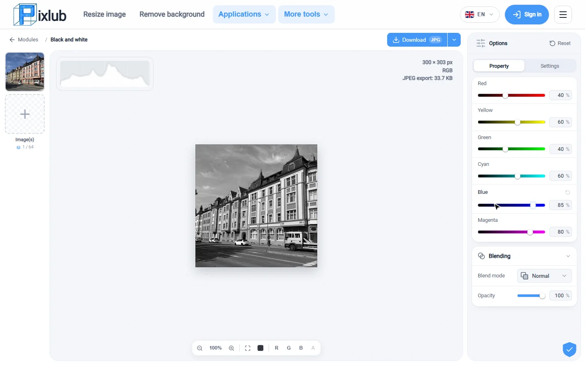

# Blanco y negro

Pasar una imagen a gris eligiendo la luminosidad de cada color.

**Categoría** : Ajuste · **Identificador** : `blackWhite` · [Referencia de la API](./api.md)

## Dónde usarlo

- **[Página del módulo](https://pixlub.com/es/module/blackWhite)** : Suelte sus archivos, ajuste y descargue: el módulo por sí solo, sin nada más.
- **[Grafo de imagen](https://pixlub.com/es/image/graph)** : Conéctelo a otros módulos para componer un efecto más complejo.

## Entradas

Los archivos que acepta la página del módulo: suéltelos en la zona de importación o haga clic en ella para buscarlos. Un archivo de otro formato se descarta, con un mensaje que recuerda los formatos permitidos.

| Entrada | Formatos aceptados | Archivos |
| --- | --- | --- |
| **Imagen(es)** (obligatoria) Imagen pasada a blanco y negro. | `PNG`, `JPEG`, `WebP`, `GIF`, `AVIF`, `BMP` | Uno o varios: cada imagen se procesa por separado, con los mismos ajustes |

El número de imágenes que se procesan a la vez depende de su plan.

Mediante la API, los archivos y sus formatos se detallan en la [vista API](./api.md).

## Presentación en video

▶ [Ver el video](../../../../assets/modules/blackWhite/demo.en.mp4) : El cielo con el azul, las fachadas con el rojo y el amarillo.

1. `0:00` Import an image
2. `0:03` Lighten the blue: the sky
3. `0:10` Red and yellow: the facades
4. `0:17` Export the result

## Uso

1. **Importar**

   Suelte una o varias imágenes: pasan a gris.

2. **Dosificar cada color**

   Un color que se sube se aclara en el gris; si se baja, se oscurece.

## Ajustes

| Ajuste | Efecto |
| --- | --- |
| **Rojo**, **Amarillo**, **Verde**, **Cian**, **Azul**, **Magenta** | 0 a 100 %: luminosidad que toma cada color. |
| **Fusión** | Modo de fusión y opacidad: cómo se aplica el ajuste sobre la imagen original. |

## Consejos

- Bajar el **azul** da un cielo oscuro y dramático, como con un filtro rojo.
- Subir el **rojo** y el **amarillo** aclara la piel.

## Exportación

El botón **Descargar** guarda el resultado en el formato del archivo importado: una foto JPEG sale en JPEG. El menú a su derecha abre los **Ajustes de exportación** para elegir otro formato y ajustar la calidad, el tamaño o el fondo, y ofrece **Copiar la imagen**.

Con varias imágenes, el botón pasa a ser **Descargar en ZIP**; el menú también ofrece los archivos por separado o solo la imagen mostrada.

- **[La ventana de exportación](../../../../01-app/es/02-image/04-exportation.md)** : Todos los formatos, sus ajustes, el procesamiento local o en el servidor, los lotes y la carpeta local.
