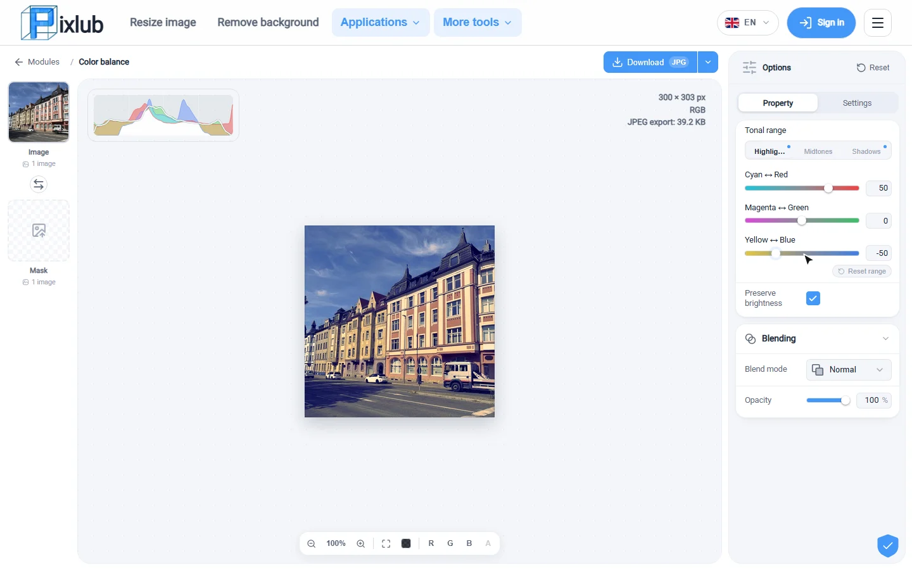

# Equilibrio de color

Teñir por separado los tonos claros, medios y oscuros de una imagen.

**Categoría** : Ajuste · **Identificador** : `colorBalance` · [Referencia de la API](./api.md)

## Dónde usarlo

- **[Página del módulo](https://pixlub.com/es/module/colorBalance)** : Suelte sus archivos, ajuste y descargue: el módulo por sí solo, sin nada más.
- **[Grafo de imagen](https://pixlub.com/es/image/graph)** : Conéctelo a otros módulos para componer un efecto más complejo.

## Entradas

Los archivos que acepta la página del módulo: suéltelos en la zona de importación o haga clic en ella para buscarlos. Un archivo de otro formato se descarta, con un mensaje que recuerda los formatos permitidos.

| Entrada | Formatos aceptados | Archivos |
| --- | --- | --- |
| **Imagen** (obligatoria) Imagen cuyos tonos se ajustan. | `PNG`, `JPEG`, `WebP`, `GIF`, `AVIF`, `BMP` | Un archivo |
| **Máscara** (opcional) Máscara opcional: el ajuste sigue su luminosidad, blanco = efecto completo, negro = ninguno. Si falta, se ajusta toda la imagen. | `PNG`, `JPEG`, `WebP`, `GIF`, `AVIF`, `BMP` | Un archivo |

Mediante la API, los archivos y sus formatos se detallan en la [vista API](./api.md).

## Presentación en video

▶ [Ver el video](../../../../assets/modules/colorBalance/demo.en.mp4) : Tonos oscuros, tonos claros, luminosidad conservada.

1. `0:00` Import an image
2. `0:02` Shadows
3. `0:08` Highlights
4. `0:16` Preserve brightness
5. `0:20` Export the result

## Uso

1. **Importar**

   Suelte una o varias imágenes.

2. **Elegir el rango**

   Las pestañas **Claros**, **Medios** y **Oscuros** eligen los tonos que se ajustan.

3. **Teñir**

   Tres controles deslizantes: cian ↔ rojo, magenta ↔ verde, amarillo ↔ azul.

## Ajustes

| Ajuste | Efecto |
| --- | --- |
| **Rango tonal** | Claros, medios u oscuros, cada uno con sus tres controles deslizantes. |
| **Conservar la luminosidad** | Solo cambia el matiz, nunca la luminosidad de la imagen. |
| **Fusión** | Modo de fusión y opacidad: cómo se aplica el ajuste sobre la imagen original. |

## Consejos

- Sombras hacia el azul y luces hacia el naranja: el etalonaje «teal & orange» del cine.
- En el [grafo de imagen](../../../../01-app/es/02-image/01-image-graph.md), una máscara limita el ajuste a una zona.

## Exportación

El botón **Descargar** guarda el resultado en el formato del archivo importado: una foto JPEG sale en JPEG. El menú a su derecha abre los **Ajustes de exportación** para elegir otro formato y ajustar la calidad, el tamaño o el fondo, y ofrece **Copiar la imagen**.

- **[La ventana de exportación](../../../../01-app/es/02-image/04-exportation.md)** : Todos los formatos, sus ajustes, el procesamiento local o en el servidor, los lotes y la carpeta local.
