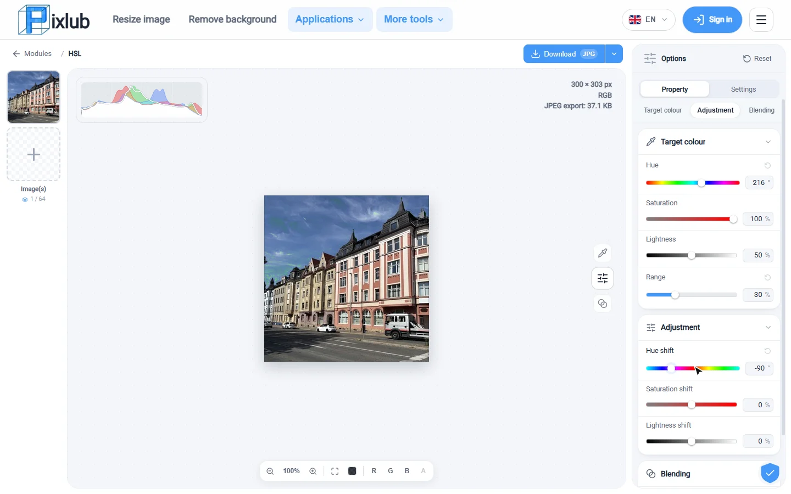

# HSL

Cambiar el tono, la saturación y la luminosidad de un solo rango de colores.

**Categoría** : Ajuste · **Identificador** : `hsl` · [Referencia de la API](./api.md)

## Dónde usarlo

- **[Página del módulo](https://pixlub.com/es/module/hsl)** : Suelte sus archivos, ajuste y descargue: el módulo por sí solo, sin nada más.
- **[Grafo de imagen](https://pixlub.com/es/image/graph)** : Conéctelo a otros módulos para componer un efecto más complejo.

## Entradas

Los archivos que acepta la página del módulo: suéltelos en la zona de importación o haga clic en ella para buscarlos. Un archivo de otro formato se descarta, con un mensaje que recuerda los formatos permitidos.

| Entrada | Formatos aceptados | Archivos |
| --- | --- | --- |
| **Imagen(es)** (obligatoria) Imagen en la que un rango de colores se desplaza en tono, saturación y luminosidad. | `PNG`, `JPEG`, `WebP`, `GIF`, `AVIF`, `BMP` | Uno o varios: cada imagen se procesa por separado, con los mismos ajustes |

El número de imágenes que se procesan a la vez depende de su plan.

Mediante la API, los archivos y sus formatos se detallan en la [vista API](./api.md).

## Presentación en video

▶ [Ver el video](../../../../assets/modules/hsl/demo.en.mp4) : Apuntar al azul del cielo y desplazar su tono, su saturación y su luminosidad.

1. `0:00` Import an image
2. `0:02` Target a colour: the sky blue
3. `0:10` Shift its hue
4. `0:13` Saturation and lightness
5. `0:20` Export the result

## Uso

1. **Importar**

   Suelte una o varias imágenes.

2. **Apuntar a un color**

   Ajuste el **color objetivo** y luego reduzca el **alcance** para modificar solo ese color.

3. **Modificarlo**

   Desplace su **tono**, su **saturación** o su **luminosidad**.

## Ajustes

| Ajuste | Efecto |
| --- | --- |
| **Color objetivo** | Tono, saturación y luminosidad de los colores que modificar. |
| **Alcance** | 0 a 100 %. Al 100 %, cambia toda la imagen. |
| **Desplazamiento de tono** | −180° a 180°. |
| **Desplazamiento de saturación** / **de luminosidad** | −100 a 100 %: hacia el gris o más vivo, hacia el negro o el blanco. |
| **Fusión** | Modo de fusión y opacidad: cómo se aplica el ajuste sobre la imagen original. |

## Consejos

- Para un cielo más profundo: apunte al azul y baje su luminosidad.
- Un alcance pequeño evita tocar la piel al modificar un naranja.

## Exportación

El botón **Descargar** guarda el resultado en el formato del archivo importado: una foto JPEG sale en JPEG. El menú a su derecha abre los **Ajustes de exportación** para elegir otro formato y ajustar la calidad, el tamaño o el fondo, y ofrece **Copiar la imagen**.

Con varias imágenes, el botón pasa a ser **Descargar en ZIP**; el menú también ofrece los archivos por separado o solo la imagen mostrada.

- **[La ventana de exportación](../../../../01-app/es/02-image/04-exportation.md)** : Todos los formatos, sus ajustes, el procesamiento local o en el servidor, los lotes y la carpeta local.
